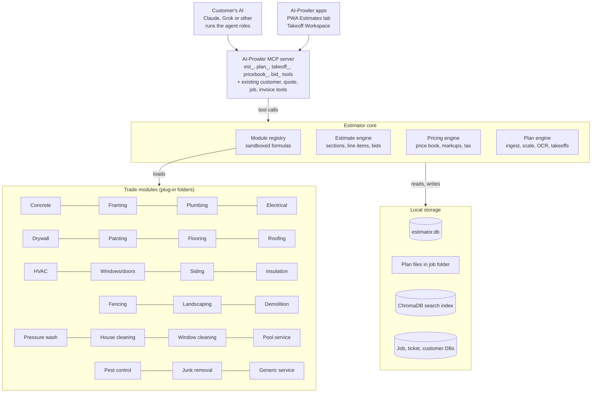
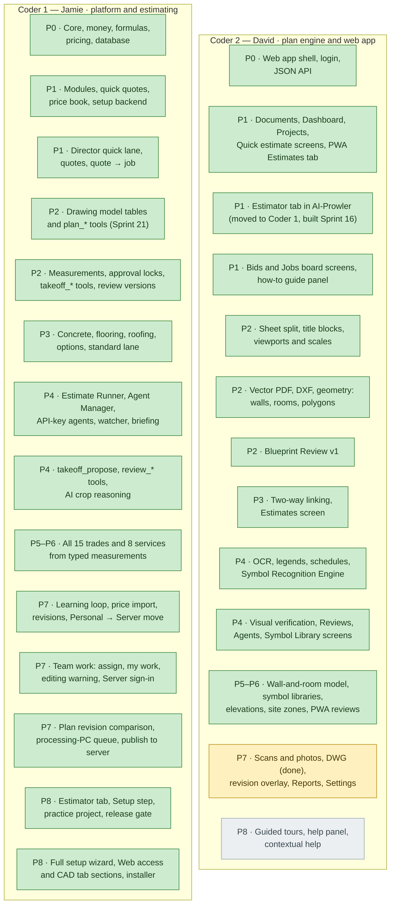
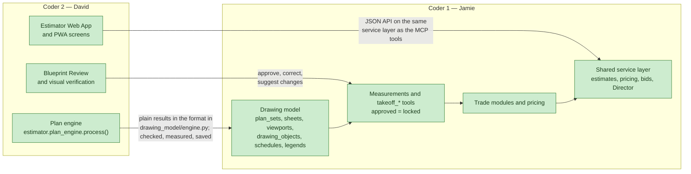

# AI-Prowler Estimating & Bidding Module — Design Spec

Nov 5, 2026 · Jamie Vavro · **Spec version 1.0 (pre-implementation)**

> **Living document.** This spec is updated as the Estimator is built and tested, as part of every sprint and phase gate (see *AI-Prowler Estimator Implementation Plan.md → Keeping the spec up to date*). Every change is recorded in the **Change log** at the end.

> **Where the build is (2026-11-09, evening).** Coder 2 (David): Sprints 1–16 are built, tested and pushed (16: scans and photos, DWG); next is Sprint 17 (revision overlay; Reports, Settings and full Price Book screens), then 18 (guided tours and help). Coder 1 (Jamie): Sprints 1–29 of the Coder 1 track are done, including plan answers into measurements (`takeoff/from_plans.py`), plan revision comparison, the processing-PC queue, the installer, the full setup wizard and the Estimator chapter of the User Guide (see the Implementation Plan's progress log). All Estimator tests: 1393 pass (both tracks merged, through Jamie's Sprint 30). Status by sprint: *Implementation Plan → Tracking → Coder 2 sprint status*.

## Overview

AI-Prowler Estimator adds plan takeoffs, trade-based estimating and bid generation to AI-Prowler as a modular feature, so a contractor can go from a set of plans (or a quick site description) to a priced, branded bid through their AI and MCP tools. It plugs into the existing Customers, Quotes, Jobs and Invoices tools, so a won bid becomes a job without re-entry.

**Goals**

- Let a small contractor produce an accurate bid in minutes instead of hours, by voice or text through their AI.
- One core engine with pluggable **trade modules**, so new trades ship without touching the core.
- A **blueprint processing engine** that reads PDF/image plans, detects scale, and measures areas, lengths and counts.
- Keep all plans, pricing and bids **local and private**, consistent with AI-Prowler's data model.
- Every number is traceable: each line item links back to the plan region, formula and price that produced it.
- Ship a complete **Estimator User Guide**, written as each feature is built, so the guide is finished when the product is.
- Make setup easy: everything needed to turn on and set up the Estimator lives in a new **Estimator tab in the AI-Prowler desktop GUI**.

**Design principles**

- **AI interprets, Python calculates.** The AI reads plans, asks questions and picks assemblies; all quantities, waste and money math run in deterministic code.
- **Human in the loop.** AI-detected measurements are proposals until the estimator confirms them.
- **Modules are data-first.** A trade module is mostly a manifest of assemblies, formulas and default prices, with optional Python hooks.

**Non-goals (v1)**

- Full BIM/IFC model authoring or 3D clash detection.
- Supplier price feeds. They are not part of these phases; later, an AI agent can be added to keep price books up to date.
- Replacing the AI client: people still chat through their own Claude, Grok or Muse. Unattended work uses the company's own Claude or Grok API keys (see AI agents and orchestration).

## Deployment modes: personal and server

The Estimator supports **one user in Personal mode** and **many users in Server mode**, matching how AI-Prowler is sold. Wherever this spec says "Business mode", it means Server mode.

| | **Personal mode** | **Server mode** |
| --- | --- | --- |
| Who it's for | A solo contractor or solo service business | A company with several estimators, reviewers, office staff and field staff |
| Where the Estimator runs | The user's own Windows PC | The AI-Prowler server box; every seat uses the same Estimator, database and project files |
| Compute | Everything, including heavy plan processing, runs on the PC (Windows 11, 16 GB RAM gaming laptop) | **Low-compute work only** on the server; heavy plan processing runs on an estimator's own PC and the results are published to the server (see Server mode compute limits) |
| Users | One user, who owns everything | Many users with their own logins |
| Login | None needed on the same PC; required for remote and phone access | Required for everyone |
| Roles and approvals | Off: the single user can do everything; approval steps become one-click confirms by that user | On: roles decide who can estimate, review, approve, change prices and send bids; second-check rules available |
| Web app access | `localhost` on the PC; phone/tablet through Remote Access | Office network (`http://<server-name>:<port>/estimator`) plus Remote Access for field staff |
| PWA | Estimates tab in the user's mobile apps | Estimates tab for every field user, each signed in as themselves |
| AI | Chat (Claude, Grok, Muse) and optional API-key agents; `chat_only` allowed | Chat for each user plus API-key agents; **every unattended agent on the server needs an API key** (matches AI-Prowler's existing rule) |
| Data folder | `%USERPROFILE%\AI-Prowler\Estimator\` | `<data drive>\AI-Prowler\Estimator\` on the server, backed up with the server's other databases |
| Setup | Estimator tab on the PC | Estimator tab on the server (admin only); users just open the web app |

**Multi-user behaviour (Server mode)**

- **Users and roles** come from AI-Prowler's existing accounts and scoping. Default roles: **Owner/Admin** (everything), **Estimator** (create and edit estimates, takeoffs, bids), **Reviewer** (review and approve counts and measurements), **Office** (bids, follow-up, jobs, invoices; no margin editing), **Field** (quick estimates, photos, mobile reviews; margins hidden). Admins can adjust permissions per role.
  - **From AI-Prowler's accounts** (2026-11-09, David): owner → Owner; manager and staff → Office; field crew → Field. Estimating is a **scope**, not a role: a manager or staff member with the **Estimating** scope (Admin → Manage Scopes) is an Estimator; field crews stay Field with or without it. Office and above approve plan symbols and measurements (desktop and phone) and see the plans they approve from (Plans, Blueprint Review, Plan quantities; scales, schedule fixes, reading plans and drawing measurements stay Owner and Estimator); Field looks at symbols and never approves. Approving a whole estimate stays Owner, Estimator and Reviewer.
- **Working at the same time**: several users can work on the same project. Each edit carries the estimate's revision number, so a stale edit is rejected with a "this changed, reload" message instead of overwriting someone's work. While a user edits a measurement or line item, others see "Maria is editing" on it.
- **Live updates**: changes made by other users, by chat or by API-key agents appear on everyone's screen without refreshing.
- **Assignments**: projects, trades and review-queue items can be assigned to a user; each user's dashboard shows "assigned to me".
- **Notifications**: review items waiting, approvals needed and bids viewed go to the right users in the web app (and by push or email where AI-Prowler already supports it).
- **Audit**: every change records which user (or which agent, on whose behalf) made it.
- **Company libraries are shared**: the price book, symbol library, firm profiles, bid templates and agent settings are company-wide; only admins and permitted roles can change them.

**Server mode compute limits**

Server mode is supported for the Estimator, but the server only does **low-compute work**, so one server box can serve the whole team without slowing down. Heavy work stays on estimators' own PCs.

| Runs on the server (low compute) | Runs on an estimator's PC (heavy) |
| --- | --- |
| Quick quotes for every service | Plan processing: splitting and rendering sheets, title-block and text OCR, vector PDF and DXF/DWG extraction |
| Standard estimates from typed measurements or a site visit | Room and wall detection, symbol detection and legend matching |
| Pricing, scenarios, price book, markups | Scanned and photo plans (raster pipeline) |
| Reviewing and approving already-processed plans (pre-rendered sheet tiles), visual verification edits, manual measurements on processed sheets | Plan revision comparison |
| Bids, sending, follow-up, quote → job | Batch AI vision over many sheets |
| The Estimating Director, daily briefings, reminders, Jobs board | |
| Multi-user editing, roles, assignments, notifications, PWA | |

AI reasoning (Claude, Grok) runs at the provider in both modes, so it adds almost no load to the server.

- **Processing PC**: any estimator's AI-Prowler install with the Estimator, signed in to the company server. When a plan set is uploaded in Server mode, the job is queued for a processing PC (the uploader's own by default). That PC processes it locally and **publishes** the results to the server: drawing model, viewports, schedules, symbol detections, proposed measurements and rendered sheet tiles. From then on everyone works on it through the server.
- **The Director routes it**: in the full plan takeoff lane, the Director shows the step as "waiting for plan processing on Maria's PC" and moves on as soon as the results are published. If no processing PC is online, the job waits and the uploader is told.
- **Server guard**: heavy jobs are blocked on the server by default. An admin setting, **Allow small plan processing on the server** (off by default), lets the server process small plan sets within limits (default: up to 10 sheets, vector PDF or DXF only, one job at a time); anything larger still goes to a processing PC.
- **Server hardware**: because the server does light work only, it needs no GPU; a normal office PC or small server with 16 GB RAM is enough for a small team.
- **Personal mode is unchanged**: one PC does everything, light and heavy.

**Switching modes**: a Personal-mode install can move to a server later. The admin exports the Estimator data folder and `estimator.db` from the PC and imports them on the server from the Estimator tab; the original user becomes the Owner/Admin.

## Scope

v1 covers fifteen construction trades with plan takeoffs plus a lightweight "quick estimate" path for service jobs. Both paths share one estimate, pricing and bid pipeline. The **Release** column shows which implementation phase delivers each module.

| Module | Path | Primary takeoff inputs | Main outputs | Release |
| --- | --- | --- | --- | --- |
| Concrete | Plan takeoff | Slab areas, footing lengths, wall lengths, thickness | Cubic yards, rebar/mesh, forms, finishing labor | Phase 3 |
| Framing | Plan takeoff | Wall lengths by type, heights, openings, roof/floor areas | Studs, plates, headers, sheathing, joists/trusses | Phase 5 |
| Plumbing | Plan takeoff | Fixture counts, pipe runs, stories | Fixtures, rough-in, pipe by material, labor by fixture unit | Phase 5 |
| Electrical | Plan takeoff | Device and fixture counts, circuit runs, panel size | Devices, wire, conduit, panels, labor by device | Phase 5 |
| Drywall | Plan takeoff | Wall lengths x heights, ceiling areas, openings | Sheets by type, mud, tape, screws, hang/finish labor | Phase 5 |
| Painting | Plan takeoff | Wall and ceiling areas, doors, trim lengths | Gallons by coat, primer, labor by surface | Phase 5 |
| Flooring | Plan takeoff | Room areas by floor type, perimeter | Material by type with waste, underlayment, transitions, base | Phase 3 |
| Roofing | Plan takeoff | Roof planes, pitch, ridge/hip/valley/eave lengths | Squares, underlayment, flashing, drip edge, tear-off | Phase 3 |
| HVAC | Plan takeoff | Conditioned sq ft, rooms, duct runs, register counts, equipment schedule | Equipment tonnage, duct lf by size, registers/grilles, line sets, labor | Phase 6 |
| Windows/doors | Plan takeoff | Window/door schedule, opening counts and sizes | Units by type and size, trim, flashing, hardware, install labor | Phase 6 |
| Siding | Plan takeoff | Elevation wall areas, openings, corners, eave/rake lengths | Squares by material, trim, corners, J-channel, house wrap, labor | Phase 6 |
| Insulation | Plan takeoff | Wall, attic and floor areas, R-value, cavity depth | Batts/rolls or blown bags by R-value, vapor barrier, labor | Phase 6 |
| Fencing | Plan takeoff or quick estimate | Fence line length, height, material, gates, corners | Posts, rails, panels/pickets, concrete bags, gates, labor | Phase 6 |
| Landscaping | Plan takeoff or quick estimate | Site plan areas by zone (sod, rock, mulch), irrigation runs, plant counts | Sod/rock/mulch volume, plants, irrigation parts, edging, labor | Phase 6 |
| Demolition | Plan takeoff or quick estimate | Areas/volumes to remove by material, stories, access | Labor hours, dumpsters/haul loads, disposal fees, equipment | Phase 6 |
| Pressure washing | Quick estimate | Surface type and sq ft, stories | Price by surface, add-ons, minimum charge | Phase 1 |
| House cleaning | Quick estimate | Bedrooms, baths, sq ft, condition, frequency | Hours, crew size, price per visit or recurring | Phase 1 |
| Window cleaning | Quick estimate | Window count by size, panes, stories, screens, inside/outside | Price per pane or window, story surcharge, add-ons | Phase 6 |
| Pool service | Quick estimate | Pool size/gallons, type, frequency, condition (green-to-clean) | Recurring service price, chemicals, one-time cleanup, repairs | Phase 6 |
| Pest control | Quick estimate | Property sq ft, pest type, interior/exterior, frequency | Initial treatment, recurring price, materials, warranty terms | Phase 6 |
| Junk removal | Quick estimate | Volume (truck fraction), item types, heavy items, stairs | Price by load, disposal fees, heavy-item surcharges | Phase 6 |
| Other services | Quick estimate | Module-defined questions | Module-defined line items | Phase 1 |

## System architecture

Estimator is a new Python package inside AI-Prowler with one core and plug-in trade modules; everything the AI or apps do goes through the existing MCP server.



- **Customer's AI** orchestrates the work by calling MCP tools, playing the agent roles described below.
- **MCP server** exposes the new Estimator tools next to AI-Prowler's existing customer, quote, job and invoice tools.
- **Estimator core** holds the estimate engine, pricing engine, plan engine and module registry. Heavy plan processing runs in the existing background task queue.
- **Trade modules** are folders the registry discovers at startup, so new trades ship without core changes.
- **Local storage** keeps everything on the customer's PC or AI-Prowler server box; in Business mode the server hosts Estimator for all seats.

## Directory structure

The Estimator ships as **one new Python package, `estimator/`, added beside AI-Prowler's existing files**. The current codebase is flat (`ai_prowler_mcp.py`, `db_*.py`, `desk_*.py`, `scheduler_*.py`, `task_queue_*.py`, `rag_gui.py`, plus app folders such as `jobs/`, `hr_admin/`, `hr_portal/`, `remote/`, `desk/`). The Estimator does **not** restructure that code. It plugs into it through a small set of bridge files, so existing releases, the installer and tests keep working.

### Source code layout

```
AI-Prowler/                          # existing repo root (flat files stay as they are)
│
├── ai_prowler_mcp.py                # EXISTING – imports estimator.mcp_tools and registers its tools
├── mcp_tool_catalog.py              # EXISTING – add Estimator tool entries
├── db_schema.py                     # EXISTING – unchanged; estimator.db has its own schema
├── task_queue_automation.py         # EXISTING – runs Estimator background jobs (plan processing, runner tasks)
├── scope_resolver.py / scope_lookup.py   # EXISTING – user/company scoping reused for Business mode
├── desk_agent*.py                   # EXISTING – agent runtime patterns reused by the Estimate Runner
├── rag_preprocessor.py              # EXISTING – indexes plan text, specs and bids into ChromaDB
├── rag_gui.py                       # EXISTING desktop GUI – adds the 🏗 Estimator tab from estimator/ui/gui_tab
├── docs/Estimator User Guide.md     # NEW – the Estimator User Guide (also summarized in COMPLETE_USER_GUIDE.md)
├── jobs/                            # EXISTING PWA – gains the Estimates tab
├── AI-Prowler-Setup.iss             # EXISTING installer – add estimator/ and its dependencies
│
├── estimator/                       # NEW – everything for estimating, takeoffs and bids
│   ├── __init__.py
│   ├── config.py                    # paths, feature flags, defaults (reads the work dir below)
│   │
│   ├── core/                        # Estimator-level shared services
│   │   ├── runner/                  # Estimate Runner: runs, trade tasks, dependencies, task states
│   │   ├── agent_manager/           # trade-agent settings (Agent Manager screen + agent_config_* tools)
│   │   ├── formula_engine/          # sandboxed expression evaluator for module formulas
│   │   ├── units/                   # unit conversion, rounding, integer-cents money
│   │   └── security/                # role checks, company scoping (wraps scope_resolver), audit log
│   │
│   ├── mcp_tools/                   # MCP tool definitions, one file per area
│   │   ├── est_tools.py             # est_* (estimates, line items, scenarios, revisions, project status)
│   │   ├── plan_tools.py            # plan_* (upload, process, sheets, viewports, objects, schedules, revisions)
│   │   ├── takeoff_tools.py         # takeoff_* (propose, list, detail, confirm, suggest_change, manual)
│   │   ├── pricebook_tools.py       # pricebook_*
│   │   ├── bid_tools.py             # bid_*
│   │   ├── runner_tools.py          # runner_*, agent_config_*
│   │   └── guide_tools.py           # how_to_estimate
│   │
│   ├── projects/                    # estimating projects, status, dashboard data
│   ├── documents/                   # upload validation, file storage, sheet splitting, rendering
│   ├── drawing_analyzer/            # Plan Engine pipeline
│   │   ├── classify/                # sheet classification, title blocks, revision letters
│   │   ├── viewports/               # viewport detection, per-viewport scale, calibration
│   │   ├── cad/                     # DXF import (ezdxf), DWG → DXF converter wrapper
│   │   ├── vector/                  # vector PDF extraction (PyMuPDF)
│   │   ├── raster/                  # deskew, OCR, line/contour detection (OpenCV, OCR engine)
│   │   ├── text/                    # dimension strings, labels, notes, keynotes
│   │   ├── schedules/               # schedule table detection and row extraction, tag linking
│   │   ├── legends/                 # legend detection and plan-set symbol dictionary
│   │   ├── symbols/                 # Symbol Recognition Engine: matching, OCR fusion, AI crop reasoning, results
│   │   │   ├── standard_library/    # shipped standard symbols (electrical, plumbing, HVAC, architectural, fire/security)
│   │   │   └── learning/            # unknown-symbol grouping and the confirm-and-save workflow
│   │   ├── interpretation/          # AI interpretation requests and results
│   │   └── revisions/               # Rev A → Rev B matching, diff, revision reports
│   ├── drawing_model/               # shared drawing data model (drawing_objects, viewports, schedules)
│   ├── geometry/                    # polygons, snapping, areas, lengths, pitch and height factors
│   ├── measurements/                # proposed/approved measurements, locking, suggested changes
│   ├── takeoff/                     # takeoff orchestration per trade, validation against schedules/notes
│   ├── estimating/                  # estimate engine: sections, assemblies, line items, scenarios, revisions
│   ├── pricing/                     # price books, markups, tax, labor burden, imports
│   ├── materials/                   # material catalog, units, coverage and pack sizes
│   │
│   ├── modules/                     # plug-in trade and service modules (see Trade module framework)
│   │   ├── registry.py              # discovers and validates modules at startup
│   │   ├── construction/
│   │   │   ├── concrete/  framing/  plumbing/  electrical/  drywall/  painting/
│   │   │   ├── flooring/  roofing/  hvac/  windows_doors/  siding/  insulation/
│   │   │   └── fencing/  landscaping/  demolition/
│   │   └── services/
│   │       ├── pressure_washing/  house_cleaning/  window_cleaning/  pool_service/
│   │       ├── pest_control/  junk_removal/  landscaping_maintenance/
│   │       └── generic_service/
│   │
│   ├── agents/                      # agent roles
│   │   ├── prompts/                 # role prompts served by how_to_estimate (director, intake, plan_reader, takeoff, pricer, reviewer, bid_writer, follow_up)
│   │   └── workflows/               # runner workflows (residential takeoff, service quick estimate, revision re-bid)
│   │
│   ├── director/                    # Estimating Director (master agent)
│   │   ├── triage.py                # picks the lane from the request
│   │   ├── jobs.py                  # shared job file (director_jobs, director_steps)
│   │   ├── engine.py                # next step, checkpoints, lane changes
│   │   ├── watcher.py               # stall watcher and daily briefing (scheduled)
│   │   └── playbooks/               # quick_quote.yaml, standard_estimate.yaml, full_takeoff.yaml + per-trade/service playbooks
│   │
│   ├── bids/                        # proposal generation, PDF/HTML templates, branding
│   ├── reporting/                   # takeoff reports, revision reports, estimate vs actual
│   ├── integrations/                # bridges to existing tools: customers, quotes, jobs, invoices,
│   │                                #   service pricing, email/SMS, QuickBooks/Excel export, self-learning
│   │
│   ├── workers/                     # background jobs run through task_queue_automation.py
│   │   ├── document_worker.py       # validation, splitting, rendering
│   │   ├── analysis_worker.py       # drawing analyzer pipeline
│   │   ├── measurement_worker.py    # trade takeoff tasks
│   │   └── estimating_worker.py     # pricing, combined estimate, bid generation
│   │
│   ├── database/
│   │   ├── schema.py                # estimator.db tables
│   │   ├── migrations/              # versioned schema migrations
│   │   └── repositories/            # data access per table group
│   │
│   └── ui/
│       ├── workspace/               # desktop Construction Estimating hub + Blueprint Review screen
│       ├── gui_tab/                 # 🏗 Estimator tab for the AI-Prowler desktop GUI (added to rag_gui.py)
│       ├── setup_wizard/            # setup wizard steps, run from the Estimator tab
│       ├── help/                    # guided tours, how-to guides (Markdown), contextual help
│       └── samples/                 # practice project: sample plan set and known answers
│       └── pwa_estimates/           # Estimates tab components for the jobs/ PWA
│
├── configurations/
│   └── estimator/
│       ├── agents/                  # default Agent Manager settings per trade (concrete.json, roofing.json …)
│       └── defaults.json            # default markups, tax mode, rounding, confidence thresholds
│
└── tests/
    └── estimator/
        ├── unit/                    # formula engine, units, money, geometry
        ├── modules/                 # golden tests runner (each module also keeps its own tests/)
        ├── drawing_analyzer/        # scale, viewports, CAD, schedules, symbols, revisions
        ├── measurements/            # approval lock, suggested changes
        ├── runner/                  # task routing, dependencies, failures
        ├── director/                # triage, playbook order, checkpoints, lane changes, stall watcher
        ├── mcp_contract/            # every Estimator MCP tool
        ├── agents/                  # scripted agent scenarios, prompt-injection tests
        ├── integration/             # quotes, jobs, invoices, exports, backups
        ├── security/                # roles, company scoping, module sandbox
        └── fixtures/                # reference plan library, DXF/DWG files, revision pairs
```

**Placement rules**

- Trade knowledge (assemblies, formulas, prices, symbols, prompts) lives **only** in `estimator/modules/<category>/<id>/`. Trade rules and agent prompts are not duplicated elsewhere.
- `configurations/estimator/agents/*.json` holds only **Agent Manager settings** (enabled, thresholds, auto-advance, sheet rules), not trade formulas.
- New MCP tools go in `estimator/mcp_tools/`, not into `ai_prowler_mcp.py`, which already exceeds 1.9 MB. `ai_prowler_mcp.py` only imports and registers them.
- Business mode multi-user and company separation reuse AI-Prowler's existing scoping (`scope_resolver.py`). Every Estimator table carries `company_id`, and every repository query filters by it. One AI-Prowler server hosts one company (decided), so no separate multi-company tenant manager is needed.

### Development work folder

Build each release in a versioned work folder, the same way as earlier AI-Prowler releases:

```
C:\Users\jamie\Documents\AI-Prowler_V970_to_V1000\
├── AI-Prowler\                      # working copy of the code (estimator\ is added here)
├── AI-Prowler Estimator Design Spec.md
├── AI-Prowler Estimator Design Spec.docx
├── design\                          # screen mockups, diagrams
├── test_plans\                      # reference plan sets, DXF/DWG samples, revision pairs (copied into tests\estimator\fixtures)
└── notes\                           # phase notes, decisions, pilot feedback
```

### Runtime work directory (customer data)

Estimator data lives in its own folder on the customer's PC or AI-Prowler server box, configurable in settings. Default:

```
%USERPROFILE%\AI-Prowler\Estimator\          # server box: <data drive>\AI-Prowler\Estimator\
├── estimator.db                             # SQLite database (backed up with the other AI-Prowler databases)
├── projects\
│   └── 2026\
│       └── EST-0001_Miller_123-Main-St\
│           ├── plans\
│           │   ├── rev_A\
│           │   │   ├── originals\           # files exactly as uploaded (PDF, DXF, DWG, images)
│           │   │   └── sheets\              # rendered sheet images for review and AI vision
│           │   └── rev_B\
│           ├── photos\                      # site photos from the PWA
│           ├── takeoffs\                    # overlay snapshots, takeoff exports
│           ├── estimates\                   # frozen estimate revisions (JSON + Excel)
│           ├── bids\                        # sent proposal PDFs, one per bid version
│           └── reports\                     # revision reports, estimate vs actual
├── price_books\
│   ├── imports\                             # supplier price lists as uploaded
│   └── exports\
├── modules_custom\                          # admin-approved custom or third-party modules
├── symbol_libraries\
│   ├── company\                             # company-approved symbol definitions and example crops
│   └── firms\                               # per-architect/engineer profiles (e.g. Smith_Architects\)
├── templates\                               # company bid templates, logo, terms
├── cache\                                   # OCR results, render tiles; safe to delete
├── logs\                                    # runner and worker logs
└── backups\                                 # estimator.db and settings backups
```

- `plans`, `photos`, `bids` and `reports` are indexed into ChromaDB so the AI can search specs, notes and past bids; `cache`, `logs` and `backups` are excluded from indexing.
- Project folders are named `EST-<number>_<customer>_<address>` so they're readable in File Explorer.
- Deleting an estimate moves its folder to a `_deleted` folder rather than removing files.

## Trade module framework

Each trade or service is a self-contained folder under `estimator/modules/construction/<trade_id>/` or `estimator/modules/services/<service_id>/` that the registry discovers at startup. Adding a trade means dropping in a folder; no core code changes.

**Module folder layout**

```
estimator/modules/construction/concrete/
  manifest.yaml        # id, name, version, category, takeoff types, questions
  assemblies.yaml      # assemblies -> components -> formulas
  pricing_defaults.csv # default material, labor, equipment unit prices
  hooks.py             # optional: custom calcs, validators, plan detectors
  prompts/             # trade-specific guidance text for the AI agent
  tests/               # golden takeoff and pricing cases
```

**Core concepts**

- **Measurement**: a typed quantity from a takeoff: `area` (sq ft), `linear` (lf), `count` (ea), `volume` (cu yd), with source (plan region, manual entry, AI proposal) and status (proposed, confirmed).
- **Assembly**: a priced recipe applied to measurements, e.g. *4" slab on grade with 6x6 mesh*. An assembly has inputs (measurements plus parameters such as thickness) and produces components.
- **Component**: one material, labor or equipment line with a formula, unit, waste factor and price key. Example: `concrete_cy = area * thickness_in / 12 / 27 * (1 + waste)`.
- **Parameters**: user-adjustable values with defaults (thickness, pitch, coats, stud spacing, crew size).
- **Price book**: company-specific unit costs, labor rates and markups that override module defaults.

**Module contract (Python interface)**

```python
class TradeModule(Protocol):
    id: str                     # "concrete"
    category: str               # "construction" | "service"
    def takeoff_types(self) -> list[TakeoffType]: ...
    def assemblies(self) -> list[Assembly]: ...
    def questions(self) -> list[Question]: ...      # quick-estimate intake
    def detect(self, sheet: Sheet) -> list[Measurement]: ...  # optional plan detector
    def calculate(self, est: TradeSection) -> list[LineItem]: ...
    def validate(self, est: TradeSection) -> list[Warning]: ...
```

Formulas run in a sandboxed expression evaluator (no `eval`; a whitelist of math functions), so a manifest can never execute arbitrary code. `hooks.py` is only loaded for signed first-party or admin-approved modules.

**Pricing stack** (applied in this order per line item): unit cost x quantity → waste → labor burden → overhead % → profit % → tax (materials only, by jurisdiction setting) → rounding rules. Each step is stored, so the bid can show or hide any layer.

## Blueprint processing and takeoff engine

The Plan Engine turns a plan set into measured, labeled regions that trade modules price. It runs locally in Python; the AI is used for interpretation (what a region is), never for the arithmetic.

**Pipeline stages**

1. **Upload and validate**: accept PDF (vector or scanned), PNG/JPG/TIFF, phone photos from the PWA, and CAD files (**DXF** directly, **DWG** through a user-installed converter). Validate before processing: file type and size limits, page count, password-protected or corrupt files, image resolution (warn under ~150 DPI), and duplicate detection against plan sets already on the estimate. Rejected files return a clear reason. Store originals in the job folder and index sheet text into ChromaDB so the AI can search specs and notes.
2. **Sheet separation and classification**: split multi-page PDFs and CAD layouts into sheets; read title blocks and sheet numbers (A-, S-, P-, E-, M-, L-, C-) to tag each sheet as architectural, structural, plumbing, electrical, mechanical, landscape, roof or site. Record sheet title, revision letter and date from the title block. The AI confirms uncertain ones.
3. **Viewport and scale detection**: find the **viewports** on each sheet (main plan, enlarged plans, detail callouts, sections), because one sheet often mixes scales such as a 1/4" floor plan beside 1" details. Parse each viewport's scale note (1/4" = 1'-0", NTS), detect graphic scale bars, and fall back to a **two-point calibration** where the user clicks a known dimension. Scale and confidence are stored **per viewport**; geometry is measured with the scale of the viewport it sits in, and anything marked NTS is never auto-measured.
4. **Geometry extraction**:
    - *CAD (DXF/DWG)*: read entities with `ezdxf` (lines, polylines, arcs, hatches, blocks, text, dimensions) in real-world units with layer names; block names identify symbols directly (e.g. a `DUPLEX_OUTLET` block). This is the most accurate path and needs no scale detection.
    - *Vector PDF*: pull lines, curves, rectangles and text with `pdfplumber`; snap and merge segments into walls and closed polygons with `shapely`.
    - *Raster (scans, photos)*: deskew, denoise and binarize (OpenCV), then detect lines and contours. *As built (Sprint 16): numpy and scipy, no OpenCV; photos are squared up to the page's edges and blueprints inverted first; horizontal and vertical lines are traced (both edges of a filled wall), and everything found is marked "needs review".*
5. **Text and dimension extraction**: OCR or read dimension strings, room labels, notes, keynotes and callouts (Tesseract, already bundled with AI-Prowler, for raster; native text for vector and CAD). Dimension strings are cross-checked against measured geometry to verify scale.
6. **Legend and schedule extraction**: detect **symbol legends** (electrical, plumbing, HVAC, architectural, abbreviation lists) and turn each into a symbol dictionary for the plan set (see Symbol Recognition Engine). Detect **schedule tables** on sheets (door, window, room finish, plumbing fixture, light fixture, electrical panel, equipment/HVAC, and wall-type legends) and convert each into structured rows (mark, type, size, material, quantity, notes). Schedule marks are linked to the matching tags on the plans, so door tag "D3" knows its size and hardware set. The AI reviews low-confidence rows.
7. **Region and symbol detection**: find rooms (closed polygons + room labels), wall runs and openings; detect and count symbols (outlets, switches, fixtures, toilets, sinks, registers) with the **Symbol Recognition Engine** below, which reads the sheet's own legend first.
8. **Build the shared drawing data model**: write everything extracted in stages 2–7 into one **drawing model**: every line, polygon, room, wall run, opening, symbol, label, dimension and schedule row, with sheet, viewport, coordinates, scale, layer, source method and confidence. Trade modules and agents read from this model instead of re-processing sheets, so a plan set is processed once and every trade uses the same consistent data.
9. **AI interpretation**: the agent reviews a sheet image plus the drawing model, assigns types ("garage slab", "exterior 2x6 wall", "LVP flooring") and flags gaps such as missing scale, unreadable areas or tags with no schedule entry.
10. **Hand off to trade agents**: each trade module queries the drawing model for what it needs (flooring asks for rooms + finish schedule; electrical asks for device symbols + panel schedule) and proposes measurements through `takeoff_propose`.
11. **Measurement**: compute areas, lengths, perimeters and counts in real units; apply pitch factors for roof planes and height for wall surfaces.
12. **Review and correct**: show overlays on the plan with color per trade; the user accepts, edits, draws or deletes regions. Only confirmed measurements flow into pricing.

### Symbol Recognition Engine

Symbols drive the count-based trades (electrical, plumbing, HVAC, doors/windows, fire/security), and the same shape can mean different things on different plans: an outlet, a plumbing fixture and a door tag can look alike. The engine therefore recognizes symbols **from the drawing's own legend first**, not only from general knowledge of what symbols usually look like. No new AI model has to be trained per trade.

**Legend-first workflow**

1. **Find the legends**: locate legend blocks (titles such as "Electrical Legend", "Symbol Legend", "Plumbing Fixture Legend", abbreviation lists) on legend sheets (often E-0.1, P-0.1, G-sheets) and on individual sheets.
2. **Build the plan-set symbol dictionary**: for each legend row, crop the symbol image as a template and read its description, subscripts and notes (e.g. `GFI`, `WP`, `IG`, `$3`, `$D`). Map each entry to a standard item type (e.g. *duplex receptacle, GFCI*) and trade. Low-confidence rows go to the estimator for confirmation before scanning starts.
3. **Scan the drawings**: search every relevant sheet for each dictionary symbol, then classify each hit using the four technologies below.
4. **Fuse into one result**: every detection becomes one standardized record linked into the drawing model.
5. **Count and assign**: count by type, sheet, room and circuit/zone where known, and hand the counts to the trade agents.

**Four technologies, one result**

| Technology | What it does | Strength |
| --- | --- | --- |
| Symbol library and legend extraction | Builds the dictionary from the legend, the company library and the standard library | Knows what symbols mean on *this* plan set |
| Computer vision | Finds repeated shapes across sheets with template and feature matching (rotation, mirroring and scale tolerant), plus an optional local detector model (Apache/BSD-licensed, e.g. YOLOX or torchvision; runs on the GPU when present) for common symbols | Fast, local, finds every occurrence and its location |
| OCR and text recognition | Reads subscripts, tags, abbreviations and nearby labels (`GFI`, `WP`, `S3`, `D3`, circuit numbers, fixture tags) | Separates look-alike symbols by their text |
| AI vision reasoning | Looks at a **small crop** around an ambiguous hit plus the legend entry and nearby text, and decides what it is | Resolves context the other three can't |

Resolution order when sources disagree: **CAD block name → plan-set legend match → company symbol library → standard library → AI reasoning**. The AI only sees small crops and structured context, never whole plan sets, which keeps cost down and private drawings local.

**Standardized symbol result** (one per detection): symbol definition, item type, trade, sheet, viewport, room, location, rotation, each source's score (legend, vision, OCR, AI), combined confidence, evidence crop, and status (proposed, approved, rejected). Low-confidence detections go to the Blueprint Review queue, where approving or relabelling one updates all matching detections on the plan set.

**Company symbol library (learns drawing conventions)**

Contractors often work with several architects and engineers, each with their own symbol style. Each company gets a persistent, growing symbol library:

- **Three levels**: the **standard library** shipped with AI-Prowler (common electrical, plumbing, HVAC, architectural and fire/security symbols); the **company library** of definitions the company has approved; and optional **firm profiles** for the architects and engineers they work with (e.g. "Smith Architects uses this symbol for a floor box"). Plan sets record the design firm so its profile is applied automatically.
- **Library view**: definitions grouped by discipline (electrical, architectural, plumbing, HVAC, fire/security) with counts, example crops, the item type and assembly each maps to, and who approved them.
- **Learning workflow**:
    1. The engine finds a symbol that matches nothing it knows.
    2. It groups all occurrences of that shape and asks the estimator once what it represents.
    3. The estimator names it and maps it to an item type (and optionally an assembly, e.g. *duplex receptacle → electrical device assembly*).
    4. AI-Prowler saves the definition with its example crops to the company library (and the firm profile when applicable).
    5. Future drawings recognize it automatically, and confidence rises as more confirmed examples are added.
- Definitions are versioned; edits never change measurements already approved. Libraries can be exported and imported (e.g. to share a firm profile between AI-Prowler installs in the same company).

**Plan revisions** (Rev A → Rev B): when a new plan set is uploaded for an existing estimate, it is matched sheet by sheet (sheet number + title) to the previous set and compared through the drawing model: added, removed and moved geometry, changed dimensions, new or changed schedule rows, and cloud/delta revision marks. The result is a **revision report** and a visual overlay (red = removed, green = added), and every confirmed takeoff touching changed areas is flagged "re-measure". Unchanged takeoffs carry over automatically, and the old set stays on file for the audit trail.

**Manual takeoff tools** (always available, also the fallback when detection fails): area polygon, rectangle, linear polyline, count stamp, cutout (subtract openings), and a typed manual quantity.

**Accuracy targets** (v1): DXF/DWG within ±0.5% (exact geometry); vector PDFs with known scale, areas and linear within ±2%; symbol counts at 95% recall before review; schedule rows at 95% of cells read correctly on vector sheets. On scanned or photo plans the engine labels results as "needs review" and never auto-confirms.

**Storage**: the drawing model keeps every extracted object; each measurement keeps the drawing objects it came from, sheet and viewport, coordinates, scale used, method (CAD, vector, raster, AI, manual), confidence, and who confirmed it.

## Construction trade modules

Each module ships default assemblies, formulas and waste factors that a company can edit in its price book. Default waste values below are starting points to be tuned per company.

| Module | Key assemblies | Core formulas | Default waste | Plan detectors |
| --- | --- | --- | --- | --- |
| Concrete | Slab on grade, thickened edge, continuous footing, spread footing, stem wall, flatwork (driveway, patio, sidewalk) | CY = sq ft x thickness in / 12 / 27; footing CY = lf x W x D / 27; rebar lf from spacing; forms = perimeter | 5-10% concrete, 10% rebar | Slab polygons, footing lines on S-sheets |
| Framing | Ext/int walls by stud size and spacing, headers, floor joists, roof rafters or trusses, sheathing | Studs = lf x 12 / spacing + corners + openings; plates = lf x 3; sheathing sheets = area / 32 | 10-15% lumber, 10% sheathing | Wall runs by line weight/hatch, openings from door/window tags |
| Plumbing | Fixture rough-in + trim per fixture, water lines, DWV, water heater, gas | Labor by fixture count x hours/fixture; pipe lf by run with fittings factor | 10% pipe | Fixture symbols on P-sheets and A-sheets |
| Electrical | Devices, lighting, circuits, panel/service, low voltage | Labor by device x hours/device; wire lf = runs x factor; boxes = devices | 10-15% wire | Outlet, switch, light, panel symbols on E-sheets |
| Drywall | Walls and ceilings by board type (1/2", 5/8" X, moisture resistant), finish level 0-5 | Sheets = (wall lf x height + ceiling area − openings) / sheet area; mud, tape, screws per 1,000 sq ft | 10-15% | Wall lengths + room ceilings from framing takeoff |
| Painting | Walls, ceilings, trim, doors, exterior siding; prime + coats | Gallons = area x coats / coverage (350-400 sq ft/gal); labor by sq ft or by item | 5-10% | Reuses drywall surfaces; door/window counts |
| Flooring | Carpet, LVP/laminate, tile, hardwood, underlayment, base, transitions | Material sq ft = area x (1 + waste); carpet by roll width; base lf = perimeter − door widths | 5-10% LVP, 10-15% tile, diagonal +5% | Room polygons with finish schedule codes |
| Roofing | Asphalt shingle, tile, metal, TPO/flat; tear-off; underlayment; flashing | Squares = plan area x pitch factor / 100; starter = eaves + rakes; ridge cap = ridge + hips | 10% gable, 15% hip/complex | Roof plan planes, ridge/hip/valley lines, pitch notes |
| HVAC | Equipment (condenser, air handler/furnace, heat pump, mini-split), ductwork trunk and branch, registers/returns, line sets, thermostats | Tonnage from load calc or sq ft per ton rule (editable); duct lf by size from runs; registers = supply count by room; labor by system + per drop | 10% duct, 5% fittings | Register and diffuser symbols on M-sheets, room areas, equipment schedule |
| Windows/doors | New construction or retrofit windows, exterior/interior doors, sliders, garage doors, trim and casing | Units from schedule; trim lf = opening perimeter; flashing per opening; labor per unit by size/type | 5% trim | Door/window tags and schedules on A-sheets |
| Siding | Vinyl, fiber cement, wood, stucco, stone veneer; house wrap; trim; soffit and fascia | Squares = (elevation wall area − openings) / 100; corners = outside/inside corner lf; J-channel = opening perimeter; soffit = eave lf x depth | 10% lap siding, 15% complex walls | Elevation sheets, wall heights, opening tags |
| Insulation | Batts, rolls, blown-in (attic), spray foam, rigid board, vapor barrier | Batt sq ft = wall/ceiling area − openings; blown bags = area x R-value depth / bag coverage; foam board-feet = area x thickness | 5-10% | Reuses wall-and-room model; attic area from roof plan |
| Fencing | Wood, vinyl, chain link, iron, block wall; gates; post footings | Posts = lf / post spacing + 1 per run + corners + gate posts; rails = sections x rails per section; pickets = lf x 12 / (picket width + gap); concrete bags per post | 5-10% | Property/fence lines on site plan |
| Landscaping | Sod, seed, decorative rock, mulch, pavers, edging, plants, irrigation (drip and spray) | Sod sq ft = area x (1 + waste); rock/mulch cu yd = area x depth in / 12 / 27; edging lf = bed perimeter; heads/emitters by zone | 5-10% sod, 10% rock/mulch | Zones and hatches on site/landscape plan |
| Demolition | Interior gut, partial demo, roof tear-off, concrete removal, selective demo | Debris cu yd = area x thickness by material x bulking factor; dumpsters = debris / container size; labor hours by material and area | Bulking factor 1.2-1.5 | Demo notes and hatched areas on demo sheets |

**Cross-trade reuse**: one confirmed wall-and-room model feeds framing, drywall, painting and flooring, so the user measures once. A change to a room polygon updates every trade section that references it and marks those sections "needs re-price".

**Regional settings**: concrete and roofing modules include hot-weather notes (pour timing, tile roof underlayment), but code-specific rules stay as editable company settings, not hard-coded.

## Simple service estimate modules

Service modules skip plans entirely: the AI runs a short intake interview (or the user fills a PWA form), and the module turns answers into line items in seconds. They reuse AI-Prowler's existing `create_service_pricing` data where a company already has rates.

**Quick estimate flow**

1. User says "Quote a pressure wash for the Garcia house" or picks a service in the PWA.
2. The agent asks only the module's required questions, skipping any it can fill from the customer record or a photo.
3. The module calculates line items, applies minimum charge and add-ons, and returns a price range or a fixed price.
4. The user approves, and the estimate becomes a quote via `create_quote`.

| Module | Intake questions | Pricing logic |
| --- | --- | --- |
| Pressure washing | Surfaces (driveway, house siding, deck, roof, fence), sq ft or dimensions, stories, stain/oil, water access | Rate per sq ft by surface x condition factor + story surcharge; add-ons (sealing, gutter brightening); minimum job charge |
| House cleaning | Beds, baths, sq ft, condition (1-5), pets, frequency (one-time, weekly, biweekly, monthly), move-in/out, add-ons (oven, fridge, windows) | Hours = base by size x condition factor; price = hours x crew rate; recurring discount by frequency |
| Window cleaning | Window count by size, panes (single/French), stories, screens, tracks, inside/outside, hard-water stains | Price per pane by size x story factor; add-ons (screens, tracks, hard-water removal); minimum charge |
| Pool service | Pool gallons or dimensions, type (chlorine/salt), spa, frequency, condition (routine or green-to-clean), equipment checks | Recurring weekly/monthly rate by size; chemicals per visit; one-time cleanup priced by condition; repair line items |
| Pest control | Home sq ft, lot size, pest type (general, termites, scorpions, rodents, bed bugs), interior/exterior, frequency | Initial service price by sq ft band; recurring price by frequency; specialty treatments as add-ons; warranty terms text |
| Junk removal | Volume (1/8 to full truck), item types, heavy/special items (appliances, hot tubs, mattresses), stairs, distance to truck | Price by load fraction; disposal and recycling fees; surcharges for heavy items, stairs and long carries; minimum charge |
| Landscaping maintenance | Lot size, lawn area, beds, trees/shrubs, frequency, irrigation checks | Recurring visit price by size; seasonal add-ons (overseed, cleanup, pruning) |
| Fencing repair / small demo | Linear feet or item count, material, haul-away | Flat or per-lf price with haul-away fee; minimum charge |
| Generic service | Module-defined | Flat, hourly, per-unit or per-area templates |

**Photo assist**: a PWA photo of a driveway or house front can be sent to the AI to estimate surfaces, but the user always confirms sizes before pricing.

**Generic service template** lets a company define a new service (gutter cleaning, window washing, lawn care) from the desktop UI with questions and a pricing formula, with no code.

## AI agents and orchestration

The **Estimating Director** (master agent, below) runs every job from first contact to a signed job and decides which of the nine specialist agents works next. The customer's AI (Claude, Grok or other) talks to the Director and calls Estimator MCP tools in the order the Director lays out, guided by role prompts that AI-Prowler serves. Long work (processing a 40-sheet plan set) runs as background tasks in AI-Prowler's existing analysis task queue, so the AI and PWA can poll status instead of blocking.

### Estimating Director (master agent)

The Director is the single front door for every estimate, whether it's a builder bidding a whole house from a plan set or a front-desk person quoting a driveway wash while the customer is on the phone. The user talks only to the Director; it figures out what kind of job it is, picks the path, hands each step to the right specialist agent, keeps the job moving, and stops for a person at the points that matter. It works the same for one-person service businesses and multi-trade contractors.

**What it does, start to finish**

1. **Intake and triage**: takes the request in plain words ("customer wants their driveway and house washed", "here are the Miller plans, bid framing, drywall and paint by Friday"), creates the job and picks a lane.
2. **Plan the job**: loads the lane's playbook and lists the stages, who does each, and where a person signs off.
3. **Dispatch**: hands each stage to a specialist agent (Intake, Quick Pricer, Plan Reader, Estimate Runner and its Takeoff agents, Pricer, Reviewer, Bid Writer, Follow-up).
4. **Watch and unstick**: tracks every open job and acts when something stalls (see below).
5. **Checkpoints**: pauses for approval before anything that changes money or reaches the customer.
6. **Close out**: hands sent bids to Follow-up, converts wins to jobs, and records what it learned.

**Lanes (picked automatically, can change mid-job)**

| Lane | Typical jobs | Agents in order | Usual time |
| --- | --- | --- | --- |
| **Quick quote** | Pressure washing, house cleaning, window cleaning, junk removal, pool and pest service | Intake → Quick Pricer → Bid Writer → Follow-up | Minutes, often while the customer is on the phone |
| **Standard estimate** | Single-trade jobs from measurements or a site visit: roof replacement, fence, HVAC changeout, flooring | Intake → Pricer → Reviewer → Bid Writer → Follow-up | An hour to a day |
| **Full plan takeoff** | Whole house or multi-trade job from a plan set | Intake → Plan Reader → Estimate Runner (dispatches Takeoff agents) → Pricer → Reviewer → Bid Writer → Follow-up | Days, mostly in the background |

Triage looks at: plans attached or not, number of trades, whether a quick-estimate module exists for the service, expected job size, and who is asking. A job can move up a lane without starting over (a "simple" roof quote becomes a full takeoff when the customer sends plans); everything already collected carries over.

**The Estimate Runner stays**: in the full takeoff lane the Director hands the multi-trade takeoff to the Runner, which still dispatches the trade agents in parallel. The Director owns the whole job; the Runner owns the parallel takeoff work inside it.

**Shared job file**: every agent reads and writes one job record instead of passing chat history: customer, lane, playbook stage, answers collected, plan sets, task states, open questions, review items, estimate revision and bid status. Any agent, any AI provider, or a person can pick up where another left off, and a user can come back days later and ask "where are we on the Miller job?".

**Playbooks**: each lane, trade and service has a short YAML playbook (same style as module manifests) listing stages, the agent for each, what must be true to move on, and the checkpoints. A new trade or service gets a playbook, not new Director code. Companies can adjust their playbooks, for example "always require a site photo before quoting roofs" or "skip the Reviewer for jobs under $500". Playbooks ship in `estimator/director/playbooks/` and are validated at startup like manifests.

**Talks to each person in their own way**

| Who | What the Director gives them |
| --- | --- |
| Contractor or estimator | Trade breakdowns, margin warnings, review counts ("3 takeoff items need your review"), due-date risk |
| Office or customer service | One question at a time to ask the customer, a price as soon as there's enough to give one, and suggested wording to read out |
| Field | Site-visit checklist, photos and measurements to collect |
| Customer directly (later release; off by default) | Asks the intake questions itself, gives a range or a firm quote by company rule, books a site visit when allowed |

The style comes from the user's role and company settings; the engine is the same.

**Checkpoints (a person decides)**

- Approving measured quantities.
- Any change to the price book or markups.
- A price below the company's minimum margin.
- The final bid total and sending the bid.
- Converting a won bid to a job.

How strict they are depends on job size: under the company's **quick-send limit** (default **$100**, configurable) a quick quote goes out after one tap ("Send this $85 quote?"); larger jobs must pass the Reviewer and get a named approver. In Personal mode an approval is a one-click confirm.

**Director settings** (per company, in the Estimator tab under AI and agents and in the web app Settings; changes are logged)

| Setting | Default | What it controls |
| --- | --- | --- |
| Quick-send limit | $100 | Quotes at or under this total can be sent with one tap; above it the Reviewer and an approver are required. $0 means every quote needs full approval |
| Book site visits on the calendar | Off | When on, the Director can propose and book site visits on AI-Prowler's calendar for staff (`get_working_days`, calendar tools); a person still confirms each booking |
| Customer-facing intake | Off (staff only) | Reserved for a later release: lets customers talk to the Director through a web form or text |
| Follow-up after | 5 days | When a sent bid with no reply goes to Follow-up |
| Daily briefing | On, 7:00 am | Time and channel (chat, PWA, email) of the briefing |
| Review reminder after | 2 days | When a waiting review triggers a reminder |

**Keeping jobs moving**

| Situation | Director action |
| --- | --- |
| Takeoff waiting on review for 2 days | Reminds the assigned estimator |
| Unclear scale or missing answer | Asks one specific question instead of failing the step |
| AI provider down or over budget | Uses the fallback provider, or parks the step as "Waiting for AI" |
| Bid sent with no reply after the company's follow-up days | Hands it to Follow-up |
| Bid due tomorrow with trades unfinished | Warns now, with what's left |
| Job idle with no owner | Asks who should take it (Server mode) |

**Daily briefing**: a short summary by chat, PWA or email, e.g. "3 quotes went out yesterday; the Smith bid is waiting on your drywall review; 2 pressure washing leads came in overnight; the Miller bid is due Friday with roofing still running." In Server mode each user gets their own briefing for the jobs assigned to them, and owners get the company view.

**What the Director never does**: it doesn't calculate quantities or prices. Numbers always come from the takeoff engine and the pricing stack through tools; the Director only decides what happens next and who does it. It follows the same guardrails as every agent (no invented numbers, money writes need a person, every action logged in `estimate_events` with the agent and the user it acted for).

**How it runs**

- **In chat**: the Director's role prompt (`estimator/agents/prompts/director.md`, served by `how_to_estimate`) plus `est_director_next`, which returns the next step, the agent and tools to use, and why. The customer's AI follows it.
- **Unattended**: a Director loop on the existing task queue uses the API-key agents (`claude_api` / `grok_api`) to run steps that need no person, and the stall watcher and briefing run on a schedule. With `chat_only`, the Director still tracks jobs and sends reminders, and parks AI steps for chat.
- **Web app**: a Jobs board shows every job by lane and stage with the Director's next step and who it's waiting on.
- **Where it lives**: in Personal mode, one Director per AI-Prowler install (one user). In Server mode, one Director per company on the server, which is light work because its reasoning runs at the AI provider; each user gets their own briefing and jobs view, owners get the company view. In Server mode it sends plan processing to a processing PC (see Server mode compute limits).

**Estimate Runner (orchestrator)**: for multi-trade construction projects, a Python runner inside AI-Prowler coordinates the work so a 25-sheet plan set doesn't depend on one long chat. The customer's AI starts and monitors it through MCP tools; the runner does the bookkeeping, and every trade agent still uses the same tools and guardrails.

Example: complete residential takeoff

1. **Create project**: the user uploads 25 architectural and structural sheets.
2. **Analyze plans**: the Plan Engine classifies sheets and tags which sheets are relevant to each trade (e.g. S-sheets for concrete, roof plan for roofing, E-sheets for electrical).
3. **Create trade tasks**: the runner creates one task per enabled trade and dispatches the concrete, framing, roofing, electrical and plumbing agents. Tasks run in parallel where they don't depend on each other; framing-dependent trades (drywall, painting, insulation) wait for the shared wall-and-room model.
4. **Execute measurements**: each agent reads the drawing model, calls the measurement engine, and stores structured quantities as proposed measurements.
5. **Validate**: measurements are checked against dimension strings, schedules (door/window counts, fixture counts, finish codes) and drawing notes; mismatches become review items.
6. **Request approval**: the task moves to **Needs review**; the estimator works the review queue in the Blueprint Review screen and approves quantities.
7. **Generate estimates**: the Estimating Engine applies the company's material pricing, labor rates and markups to approved quantities only.
8. **Deliver**: individual trade estimates plus a combined construction estimate, ready for the Bid Writer.

Task states: Queued → Running → Needs review → Completed (or Blocked / Failed with a reason). Task progress shows on the project dashboard and is pollable from the PWA. A failed or blocked trade never stops the other trades.

**Takeoff engine and Estimating engine stay separate.** The takeoff engine answers *how much* (quantities with sources); the estimating engine answers *how much it costs* (prices, labor, markups). Quantities can be re-priced without re-measuring, and price-book changes never touch measurements.

**Finalized estimates are protected.** Once an estimate is approved or a bid is sent, it cannot be edited in place; any change creates a new **estimate revision** (v2, v3…) with a change summary, and earlier revisions stay viewable.

| Agent role | Job | Main tools | Hands off to |
| --- | --- | --- | --- |
| **Estimating Director** (master) | Single front door; triages each job into a lane, runs the lane's playbook, dispatches the other nine agents, enforces checkpoints, unsticks stalled jobs, sends daily briefings | `est_director_start`, `est_director_next`, `est_job_status`, `est_jobs_board`, `est_director_briefing` | Every agent below, then back to the Director |
| Estimate Runner | Creates trade tasks from classified sheets, dispatches trade agents, tracks task states, triggers validation and estimate generation | `runner_start`, `runner_status`, `runner_retry_task` | Trade agents, then Pricer |
| Intake | Collects job, customer, address, trades wanted, due date; creates the estimate | `est_create_estimate`, `create_customer`, `est_quick_questions` | Plan Reader or Quick Pricer |
| Plan Reader | Uploads and validates plans (PDF, images, DXF/DWG), classifies sheets, confirms viewport scales, reviews schedules, compares revisions | `plan_upload`, `plan_process`, `plan_get_sheets`, `plan_get_viewports`, `plan_set_scale`, `plan_get_schedules`, `plan_compare_revisions` | Takeoff |
| Takeoff (one per trade) | Reads the shared drawing model, proposes measurements, asks the user to confirm unclear ones | `plan_get_objects`, `takeoff_propose`, `takeoff_list`, `takeoff_confirm` | Pricer |
| Quick Pricer | Runs service intake and prices simple jobs | `est_quick_answer`, `est_calculate` | Bid Writer |
| Pricer | Applies assemblies and price book, runs scenarios (good/better/best) | `est_apply_assembly`, `est_calculate`, `pricebook_get` | Reviewer |
| Reviewer (QA) | Checks for missing trades, outlier unit costs, unconfirmed takeoffs, margin below floor | `est_validate`, `est_compare_history` | Bid Writer |
| Bid Writer | Writes scope, inclusions, exclusions, terms; generates the proposal PDF | `bid_generate`, `bid_preview`, `send_email` | Follow-up |
| Follow-up | Tracks sent bids, reminds, converts wins to jobs | `bid_set_status`, `create_job`, `send_customer_reminders` | — |

### How the AI controls the Estimator: chat and API-key agents

The whole estimating process can be run three ways, and they can be mixed on the same project:

| Mode | Who drives | How it connects | Used for |
| --- | --- | --- | --- |
| **Chat control (MCP)** | A person talking to their AI: Claude (Claude Desktop or a claude.ai connector), Grok, or Muse | AI-Prowler's MCP server, locally or through the remote-access tunnel | Interactive work: "estimate the Miller plans", "show me what still needs review", "send the bid" |
| **API-key agents (unattended)** | AI-Prowler's own background agents | The agents' own API keys, `claude_api` (Anthropic) or `grok_api` (xAI) | The Estimate Runner's trade agents, AI sheet interpretation, symbol crop reasoning, Reviewer checks, bid drafts and follow-ups, running with nobody watching |
| **Web app** | A person clicking | The Estimator web app (see Estimator Web App) | Visual review, approvals, settings |

**API-key agents follow AI-Prowler's existing agent pattern** (`desk_agent_providers.py`, `desk_agent_budget.py`, `task_queue_automation.py`):

- **Keys**: every unattended Estimator agent uses the agents' own keys entered under 🔑 Agent API Key in the Small Business tab (`~/.ai-prowler/agent_claude_api_key.txt`, `~/.ai-prowler/agent_grok_api_key.txt`). They never use the Task Queue keys or environment variables, matching the existing rule. Keys are never stored in `estimator.db`, never sent to the web browser, never written to logs, and shown masked with a "Test connection" button.
- **Provider per agent role**: in Agent Manager, each role (Plan Reader, each trade's Takeoff agent, symbol reasoning, Reviewer, Bid Writer, Follow-up) picks `claude_api`, `grok_api` or `chat_only`, a model, and an optional fallback provider (e.g. Claude first, Grok if Claude fails or is over budget). Models and prices come from `task_automation_config.json` (`agent_claude_model`, `agent_grok_model`, `agent_prices`).
- **`chat_only`**: for installs without an API key, nothing AI-based runs on its own. The Runner still does all the non-AI work (parsing, geometry, legend matching, pricing math) and parks AI steps as "Waiting for AI" until someone runs them from chat. On a server box, every unattended agent needs an API key.
- **Same safety policy as chat**: a headless agent receives one task's context pack (sheet crops, drawing-model data, legend, allowed actions) and replies with JSON actions only. The Estimator validates and applies them through the same service layer the MCP tools and web app use. Agents never get direct database access, never invent numbers, and money-changing actions (price book, markups, final bid totals, sending bids) still wait for a person to approve.
- **Budgets**: the existing budget meter tracks tokens and cost per run, per day and per month, per provider. A run pauses at its limit and shows why. Usage and cost per project appear on the project dashboard.
- **Audit**: every agent action records provider, model, cost, inputs summary and result in `estimate_events`.

**Guardrails for all agents**

- Agents never invent quantities or prices: every number must come from a tool result.
- Any write that changes money (price book, markup, final bid total) needs user confirmation in chat or the PWA.
- Agents record decisions and corrections with `record_learning`, so the Reviewer can learn a company's habits ("we always add 2 extra squares on tile roofs").
- Each agent's role prompt ships in `estimator/agents/prompts/` and is returned by a `how_to_estimate` tool, the same pattern as `how_to_use_ai_prowler`.

## MCP tool catalog

About 45 new tools, prefixed by area so the AI can find them, registered in the same MCP server as AI-Prowler's existing tools. All return JSON with ids, units and a `warnings` list.

| Area | Tool | Purpose | Writes? |
| --- | --- | --- | --- |
| Guide | `how_to_estimate` | Returns workflow, agent role prompts and the how-to guides (by topic or question) | No |
| Director | `est_director_start` | Start a job from a plain-language request: creates the job file and estimate, picks the lane and playbook, returns the first step | Yes |
| Director | `est_director_next` | The next step for a job: which agent, which tools, what's needed from the user, and why; also accepts the result of the last step | Yes; sending the quote (`send`) and making the job (`convert`) need confirm |
| Director | `est_director_change_lane` | Move a job to another lane, keeping everything collected | Needs confirm |
| Director | `est_job_status` / `est_jobs_board` | One job's stage, open questions, who it's waiting on; all open jobs by lane and stage | No |
| Director | `est_director_briefing` | Daily briefing for the user (or company view for owners) | No |
| Director | `est_playbook_list` / `est_playbook_update` | Read playbooks; adjust company overrides (required steps, extra checkpoints) | Update needs confirm |
| Director | `est_director_settings_get` / `est_director_settings_update` | Quick-send limit, calendar booking, customer-facing intake, follow-up days, briefing, reminders | Update needs confirm |
| Setup | `est_setup_status` | Setup wizard progress: completed, skipped and remaining steps | No |
| Setup | `est_setup_step` | Save one setup step (company profile, trades, tax, labor, markups, price book, template, roles, AI) | Needs confirm |
| Setup | `est_sample_project` | Create or delete the practice project | Yes |
| Modules | `est_list_modules` | Installed trades, versions, takeoff types | No |
| Modules | `est_get_assemblies` | Assemblies and parameters for a trade | No |
| Estimate | `est_create_estimate` | New estimate tied to customer and address | Yes |
| Estimate | `est_get_estimate` / `est_list_estimates` | Read one or search estimates | No |
| Estimate | `est_add_trade` / `est_remove_trade` | Add or drop a trade section | Yes |
| Estimate | `est_apply_assembly` | Apply an assembly to measurements with parameters | Yes |
| Estimate | `est_add_line_item` / `est_update_line_item` | Manual line items and overrides | Yes |
| Estimate | `est_calculate` | Recompute all quantities and totals | Yes |
| Estimate | `est_validate` | QA checks, returns warnings | No |
| Estimate | `est_scenarios` | Good/better/best or alternate pricing | Yes |
| Estimate | `est_compare_history` | Compare unit costs to past estimates and actuals | No |
| Quick | `est_quick_questions` / `est_quick_answer` | Service intake interview | Yes |
| Plans | `plan_upload` | Get upload URL or attach an indexed file | Yes |
| Plans | `plan_process` | Start background processing, returns task id | Yes |
| Plans | `plan_status` | Progress of a processing task | No |
| Plans | `plan_get_sheets` / `plan_get_sheet_image` | Sheet list, types, scale; rendered page for AI vision | No |
| Plans | `plan_set_scale` | Set scale or two-point calibration for a viewport | Yes |
| Plans | `plan_get_viewports` | Viewports on a sheet with scale and confidence | No |
| Plans | `plan_get_objects` | Query the drawing model by sheet, kind, layer, tag or area | No |
| Plans | `plan_get_schedules` / `plan_update_schedule_row` | Read extracted schedules; correct a row | Update: Yes |
| Plans | `plan_get_rooms_walls` | The shared wall-and-room model: rooms (area, perimeter, height, surfaces), walls (interior/exterior, length, thickness), doors and windows (schedule sizes), totals | No |
| Plans | `plan_trade_answers` | Each trade's quick-estimate answers from the plans: wall-and-room trades from the one model, electrical and plumbing from approved symbols; where each answer came from | No |
| Symbols | `plan_get_legends` | Legends found on a plan set and the symbol dictionary built from them | No |
| Symbols | `symbol_detections_list` | Detections by type, sheet, room, status and confidence, with counts | No |
| Symbols | `symbol_detection_review` | Approve, relabel or reject a detection (applies to all matches on request) | Yes |
| Review | `review_highlight` | Locations of every item behind a count or quantity, for highlighting on the plan | No |
| Review | `symbol_find_similar` | Search all sheets for more matches of a selected symbol | Yes |
| Review | `review_start` / `review_save` / `review_approve` | Open a review on a count or measurement, save changes as a new version, approve it | Yes |
| Review | `review_history` | All versions of a count with who changed what | No |
| Symbols | `symbol_library_list` / `symbol_define` | Browse the standard, company and firm libraries; save a newly confirmed symbol with examples | Define needs confirm |
| Plans | `plan_compare_revisions` | Compare two plan sets; returns revision report and flagged takeoffs | Yes |
| Server | `plan_processing_queue` | Server mode: plan sets waiting for a processing PC, which PC has each, and progress | No |
| Server | `plan_publish_to_server` | On a processing PC: send a processed plan set's results (drawing model, schedules, detections, proposed measurements, sheet tiles) to the company server | Yes |
| Takeoff | `takeoff_propose` | Detected regions for a trade on a sheet | Yes |
| Takeoff | `takeoff_list` | Measurements with status and confidence | No |
| Takeoff | `takeoff_confirm` / `takeoff_edit` / `takeoff_delete` | Review actions | Yes |
| Takeoff | `takeoff_manual` | Add a typed or drawn measurement | Yes |
| Takeoff | `takeoff_detail` | Calculation, scale, viewport, source page and objects, confidence, approval history | No |
| Takeoff | `takeoff_suggest_change` | Propose a new value for an approved (locked) measurement; never overwrites it | Yes |
| Runner | `runner_start` / `runner_status` / `runner_retry_task` | Start the multi-trade run, poll task states, retry a failed or blocked trade | Yes |
| Project | `est_project_status` | Project dashboard: overall status, per-trade task states, headline quantities | No |
| Agents | `agent_config_get` / `agent_config_update` | Read or change trade-agent settings (enabled, thresholds, sheets, auto-advance) | Update needs confirm |
| Estimate | `est_create_revision` | New revision of a finalized estimate with change summary | Yes |
| Pricing | `pricebook_get` / `pricebook_update` | Company prices, labor rates, markups | Update needs confirm |
| Pricing | `pricebook_import` | Import CSV or Excel price lists | Needs confirm |
| Bid | `bid_generate` / `bid_preview` | Build proposal PDF and HTML preview | Yes |
| Bid | `bid_send` | Email bid via existing `send_email` | Needs confirm |
| Bid | `bid_set_status` | Draft, sent, viewed, won, lost, expired | Yes |
| Bid | `bid_convert_to_job` | Won bid → `create_quote` + `create_job` | Needs confirm |
| Export | `est_export` | Excel, CSV, QuickBooks CSV via existing exporters | No |

**Conventions**: units are always explicit fields (`qty`, `unit`); money is integer cents; every write returns the new `estimate_rev` so stale edits from two users are rejected; tools respect AI-Prowler's existing write-access grants per directory and per user.

## Data model

A new SQLite database, `estimator.db`, sits beside the existing job and ticket databases and uses the same backup and restore tools. Plan files live in the job folder and are indexed into ChromaDB for search.

| Table | Key fields | Notes |
| --- | --- | --- |
| `estimates` | id, customer_id, job_id, address, title, status, rev, revision, parent_estimate_id, change_summary, created_by, due_date, totals_json | customer_id links to existing customers |
| `trade_sections` | id, estimate_id, module_id, module_version, params_json, needs_reprice | One per trade in the estimate |
| `plan_sets` | id, estimate_id, file_path, file_type (pdf/image/dxf/dwg), page_count, revision, supersedes_plan_set_id, validation_json, processed_at | Original upload; revision chain |
| `sheets` | id, plan_set_id, page_no, sheet_no, title, discipline, revision, revision_date, units | |
| `viewports` | id, sheet_id, bbox_json, label, scale_ratio, scale_method, scale_confidence, is_nts | One sheet can hold several scales |
| `drawing_objects` | id, sheet_id, viewport_id, kind (line/polyline/polygon/room/wall/opening/symbol/text/dimension), geometry_json, real_units_json, layer, block_name, label, tag, source (cad/vector/raster/ai/manual), confidence, revision_status | Shared drawing data model read by all trades |
| `schedules` | id, sheet_id, schedule_type (door/window/finish/plumbing/lighting/panel/equipment/wall-type), title, bbox_json, confidence | |
| `schedule_rows` | id, schedule_id, mark, fields_json, linked_object_ids, confidence, reviewed_by | Mark links schedule rows to plan tags |
| `legends` | id, sheet_id, discipline, title, bbox_json, confidence | Legend blocks found on sheets |
| `symbol_libraries` | id, company_id, level (standard/company/firm), firm_name, version, updated_at | Standard, company and firm profiles |
| `symbol_definitions` | id, library_id, legend_id, code, description, subscripts_json, item_type, trade, assembly_id, ocr_aliases_json, status, approved_by, version | One meaning of a symbol |
| `symbol_examples` | id, definition_id, image_path, source_sheet_id, source (legend/confirmed/standard) | Template crops for matching |
| `symbol_detections` | id, drawing_object_id, definition_id, sheet_id, viewport_id, room_id, location_json, rotation, scores_json (legend/vision/ocr/ai), confidence, evidence_crop, status, reviewed_by | Standardized symbol result |
| `reviews` | id, estimate_id, target_type (count/measurement/detection_set/schedule), target_id, version, base_version, status (unreviewed/in_review/approved), changes_json (added/removed/relabelled/edited), result_qty, reviewer_id, approver_id, second_check_by, created_at, approved_at | Approved review versions; originals never overwritten |
| `company_profile` | company_id, name, logo_path, address, phone, license_no, colors_json, service_area_json, tax_rules_json, crop_sending_enabled | Filled by the setup wizard |
| `setup_progress` | company_id, step, status (not_started/done/skipped), data_json, updated_by, updated_at | Wizard progress and hub checklist |
| `help_progress` | user_id, tour_id, status (not_started/completed/skipped), updated_at | Which guided tours each user has seen |
| `revision_reports` | id, old_plan_set_id, new_plan_set_id, summary_json, changed_object_ids, flagged_measurement_ids, created_at | Rev A → Rev B comparison |
| `measurements` | id, sheet_id, viewport_id, trade_section_id, layer, kind, qty, unit, source_object_ids, calc_json, geometry_json, method, confidence, status (proposed/approved/rejected), locked, suggested_qty, needs_remeasure, proposed_by, approved_by, approved_at | Approved = locked; AI changes go to suggested_qty |
| `takeoff_tasks` | id, estimate_id, run_id, module_id, sheet_ids, depends_on, state (queued/running/needs_review/completed/blocked/failed), progress, error, started_at, finished_at | One per trade per run |
| `runs` | id, estimate_id, plan_set_id, started_by, state, created_at | Estimate Runner executions |
| `agent_configs` | company_id, module_id, enabled, confidence_threshold, auto_advance, sheet_rules_json, defaults_json | Agent Manager settings |
| `layers` | id, estimate_id, name, color, visible, locked, is_system | Blueprint Review layers |
| `plan_markups` | id, sheet_id, kind (cloud/text/highlight/stamp/attachment), geometry_json, text, author, created_at | Review markup |
| `assembly_uses` | id, trade_section_id, assembly_id, params_json, measurement_ids | |
| `line_items` | id, trade_section_id, assembly_use_id, kind (material/labor/equipment/sub), description, qty, unit, unit_cost_cents, waste, markup_json, total_cents, override_by | Full calc trace kept |
| `price_book` | id, company_id, price_key, unit, cost_cents, labor_hours, supplier, effective_date | Versioned by date |
| `markups` | company_id, overhead_pct, profit_pct, tax_rules_json, burden_pct, min_margin_pct | |
| `bids` | id, estimate_id, version, scope_text, inclusions, exclusions, terms, pdf_path, status, sent_at, valid_until | |
| `estimate_events` | id, estimate_id, actor, action, before_json, after_json, at | Audit trail |
| `director_jobs` | id, company_id, estimate_id, customer_id, lane, playbook_id, playbook_version, stage, state (active/waiting_on_user/waiting_on_ai/waiting_on_customer/done/cancelled), waiting_on, assigned_to, due_date, request_text, answers_json, open_questions_json, next_step_json, rev, created_at, updated_at | The shared job file every agent reads and writes |
| `director_steps` | id, job_id, stage, agent_role, provider, state (queued/running/done/blocked/failed/skipped), input_summary, result_json, started_at, finished_at | One row per step the Director hands out |
| `playbook_overrides` | company_id, playbook_id, overrides_json, updated_by, updated_at | Company changes to shipped playbooks |
| `director_settings` | company_id, quick_send_limit_cents (default 10000), calendar_booking_enabled (default 0), customer_intake_enabled (default 0), follow_up_days (5), review_reminder_days (2), briefing_enabled, briefing_time, briefing_channel, updated_by, updated_at | Director settings; every change logged |

**Versioning**: an estimate is editable until it is approved or a bid is sent; after that, changes create a new estimate revision (`estimates.revision`, `parent_estimate_id`) with a change summary. Sending freezes a bid version with a snapshot of line items and prices, so later price-book changes never alter a sent bid.

## Pricing, bids and integration

A bid is generated from a frozen estimate version and flows into AI-Prowler's existing quote, job and invoice tools, so nothing is typed twice.

**Price book setup**

- Starts from each module's default prices, marked "sample, verify before use".
- Import supplier price lists from CSV or Excel (`pricebook_import`), mapping columns to price keys with AI help.
- Labor rates by crew type, with burden %; subcontractor lines for trades the company doesn't self-perform.
- **Learning loop**: when a job closes, actual costs from time entries (`log_time_entry`) and receipts are compared to the estimate and shown as suggested unit-cost updates.

**Bid document** (PDF + HTML preview, company logo and colors)

- Cover, scope by trade, line items or lump sum per trade (company choice), alternates and options, inclusions, exclusions, allowances, payment schedule, validity date, signature block.
- Good/better/best options for service jobs and finish-level choices.
- Optional plan snapshot showing measured areas, which builds customer trust.

**Integration with existing AI-Prowler tools**

| Existing tool | How Estimator uses it |
| --- | --- |
| `create_customer` | Intake agent creates or links the customer |
| `create_quote` | Accepted estimate becomes a quote record |
| `create_job` / `create_job_from_ticket` | Won bid converts to a job; ticket requests can start an estimate |
| `create_invoice` | Progress or final invoices from bid payment schedule |
| `create_service_pricing` | Seed prices for service modules |
| `send_email` / `text_receipt` | Send bids and follow-ups |
| `export_to_quickbooks_csv` / `export_to_excel` | Export estimates and won jobs |
| `create_analysis_task` / `desk_agent_*` | Background plan processing and bid follow-up |
| `search_documents` / `index_path` | Search specs and past bids in ChromaDB |
| `record_learning` | Store company estimating habits |
| `get_file_upload_url` | PWA plan and photo uploads |
| `build_daily_route` | Schedule site visits for estimates |

## User interface

Three surfaces: chat with the AI (primary), a desktop **Construction Estimating** section for plan review and estimate management, and an Estimates tab in the PWA for field use.

### Construction Estimating hub

A local web page served by AI-Prowler and opened in the browser (on the same PC, or from other PCs on the office network in Business mode), with four areas:

| Area | Purpose |
| --- | --- |
| **Projects** | Create and manage estimating projects: customer, address, plan sets, trades, due date, status |
| **Takeoffs** | Measurements and quantities by trade; opens the Blueprint Review screen |
| **Estimating** | Costs, markups, scenarios, trade estimates, combined estimate and proposals |
| **Agent Manager** | Configure trade agents: enable/disable per trade, default assemblies, waste factors, confidence thresholds, which sheets each agent reads, and whether results auto-advance or wait for review |

**Project dashboard**: each project shows an overall status (Uploading → Processing plans → Measurement review → Pricing → Bid sent → Won/Lost) and a status line per item:

| Item | Status values |
| --- | --- |
| Plan sets / sheets | Uploaded, Processing, Processed, Failed (with reason) |
| Each trade takeoff | Queued, Running, Needs review, Completed, Blocked (e.g. missing scale) |
| Each trade estimate | Not started, Draft, Ready, Approved |
| Bid | Draft, Sent, Viewed, Won, Lost, Expired |

Below the status list, **takeoff result tiles** show headline quantities per trade (e.g. slab sq ft, concrete cubic yards, roof squares, wall lf, flooring sq ft) with their review state, so the estimator sees at a glance what's done and what needs attention.

### Blueprint Review screen

A split-screen workspace and the main place the estimator checks AI work.

- **Left: the original blueprint** with zoom/pan, sheet and page navigation, and color overlays per trade or per room (each room filled and labelled with its area, dimensions drawn along walls).
- **Tool palette**: polygon, rectangle, arc, circle, length, area, volume, count, angle, dimension, calibrate scale, cutout; markup tools (cloud, text, highlight, stamp, photo/link attachment); view tools (fit, zoom to selection, full screen).
- **Layers panel**: toggle and lock layers such as Measurements, Floor plan, Walls, Doors & windows, Furniture, Plumbing, Electrical, Dimensions and user-created layers. CAD layers map to these automatically.
- **Right: extracted measurements and material list**, grouped by trade and room, with running totals (total area, total length, counts).
- **Two-way linking**: selecting a material or line item highlights every measurement on the blueprint that feeds it; selecting a region on the blueprint highlights its measurements and the materials they drive.
- **Measurement detail panel** (click any measurement): the calculation with every input, scale and viewport used, source sheet and page, source drawing objects, method (CAD, vector, raster, AI, manual), confidence, who proposed it, who approved it and when.
- **Approve or correct**: the estimator approves a measurement, edits its geometry or value, or rejects it. Bulk approve is available for high-confidence items above the agent's threshold.
- **Human-approved measurements are locked.** The AI never silently overwrites an approved measurement. If a re-run or plan revision produces a different value, it is shown as a **suggested change** beside the approved value, and only a person can accept it. Every change is recorded in `estimate_events`.
- **Review queue**: a filter for "Needs review" items, sorted by lowest confidence and biggest cost impact first.

### Visual verification of counts and detections

Every count or quantity the AI produces can be checked visually before it's priced.

- **Click any number to see it on the plan.** Clicking "75 duplex outlets" (in the material list, the trade estimate or the project dashboard) highlights all 75 on the blueprint, across every sheet, with a sheet-by-sheet breakdown and next/previous navigation through each hit.
- **Symbol detection panel** (side panel): a thumbnail grid of every matched symbol crop with its sheet and confidence. The estimator can select or deselect matches in bulk, sort by confidence to check the doubtful ones first, filter by sheet, room or type, and open any thumbnail to jump to it on the plan. The panel shows "168 matches, 122 selected" style totals and saves with one click.
- **Fix misses and false hits.**
    - *Missed symbol*: click it on the plan (or box-select an area) to add it; "**Find similar**" then searches all sheets for more of the same shape and adds them as proposed matches.
    - *Wrong match*: deselect it, or relabel it as a different symbol type (e.g. outlet → floor box); relabelling can apply to all identical matches at once.
    - *Wrong area or length*: edit the shape directly on the plan; the quantity and every linked line item update.
- **Corrections teach the system.** Every confirmed add, removal or relabel is saved as an **approved example** for that symbol definition in the company library (and firm profile when one applies). Future plan sets use these examples, so accuracy improves with use: **AI detects → estimator verifies → system learns → future drawings improve.**
- **History is never rewritten.** The original AI detection result is kept. A review creates a new **approved review version** of that count (who, when, what changed: +3 added, −2 removed, 1 relabelled), which becomes the value used for pricing. Earlier versions stay viewable, and estimates already sent keep the counts they were priced with.
- **Review status per count**: Unreviewed → In review → Approved (with reviewer name and date). Bids can be set to require every count and measurement on the estimate to be approved before sending.
- **Reviewer roles** (Business mode): field staff and estimators can review; only roles with approval rights can approve; a second-person check can be required for counts above a cost threshold.
- **Cross-sheet checks** shown during review: a symbol's count is compared with linked schedules, circuit numbers, room labels and equipment tags (e.g. 12 light fixtures counted but the lighting schedule lists 14; a "D7" tag with no door schedule row), and mismatches are flagged on the review screen.

### Estimator tab in the AI-Prowler GUI (setup)

All Estimator setup lives in a new **🏗 Estimator** tab in the AI-Prowler desktop GUI, next to the existing tabs (such as Small Business). It is where a company turns the Estimator on, sets it up and checks that it's healthy. Day-to-day estimating happens in the Estimator Web App; the tab is for setup and administration.

To keep `rag_gui.py` from growing further, the tab is built in its own module (`estimator/ui/gui_tab/`) and `rag_gui.py` only adds the tab and calls it.

| Tab section | Controls |
| --- | --- |
| **Status** | Estimator on/off; web app running or stopped with Start / Stop / **Open Estimator** buttons; web app address (local and office network); version; health checks (database, data folder, OCR, GPU detected, AI provider connected) with a green/red light each |
| **Setup wizard** | Start or resume the setup wizard (below); checklist of completed and skipped steps |
| **Company** | Company name, logo, address, license number, colors (shortcut to wizard steps 1, 3) |
| **AI and agents** | Shows whether the agent API keys in the Small Business tab are set (masked) with a link to that tab; provider and model per agent role; fallback provider; daily/monthly budget; symbol-crop sending on/off |
| **Web app access** | Port; allow office-network access; HTTPS certificate; remote access through the Remote Access service; who can log in |
| **Data and backups** | Estimator data folder location (default `%USERPROFILE%\AI-Prowler\Estimator\`); disk space used; back up now; restore; folders indexed into ChromaDB |
| **CAD and tools** | DXF support status; DWG converter detected or not, with guidance to install the free ODA File Converter; Tesseract OCR status |
| **Modules** | Trades and services turned on; module versions; custom modules folder |
| **Help** | Open the Estimator User Guide; open the practice project; replay tours; support contact |

### Setup wizard (first run)

A step-by-step wizard that gets a company ready to send its first real bid. It runs in the **Estimator tab** of the AI-Prowler GUI. It starts automatically the first time the Estimator is turned on, can be re-run any time from the tab, and follows the same style as AI-Prowler's existing setup wizard (`setup_wizard.py`). The web app shows a reminder banner with an "Open setup in AI-Prowler" link until setup is complete. Progress is saved after each step, steps can be skipped and finished later, and a checklist on the hub shows what is still incomplete.

| Step | What the user does | Notes |
| --- | --- | --- |
| 1. Company profile | Company name, logo, address, phone, license number, brand colors | Used on bids |
| 2. What you do | Pick trades and services (concrete, roofing, pressure washing, pool service…) | Turns on only those modules and agents; others can be added later |
| 3. Service area and tax | Location, sales tax rules, whether tax applies to materials only | Sets defaults for every estimate |
| 4. Labor rates | Crew types, hourly rates, labor burden % | Pre-filled with editable sample values |
| 5. Markups | Overhead %, profit %, minimum margin, rounding, minimum job charge | Reviewer agent warns when a bid falls below the minimum margin |
| 6. Price book | Review sample prices per selected trade, or import a supplier price list (CSV/Excel) | Sample prices stay marked "sample" until reviewed; the first bid can't be sent with unreviewed sample prices |
| 7. Bid template | Pick a template; set terms, payment schedule, warranty text, validity days | Live preview |
| 8. Team and approvals (Business mode) | Who can estimate, review, approve and send bids; second-check threshold | Uses AI-Prowler users and roles |
| 9. AI and privacy | Confirm the AI client is connected (Claude first); symbol-crop sending (on by default, with the one-time notice) | Runs a quick connection test |
| 10. Try it | Run a sample project end to end: a sample plan set or a sample pressure-washing quote | Sample data is clearly labelled and can be deleted in one click |

When the wizard finishes it shows a "Ready to estimate" summary with any skipped steps, and links to the how-to-use guide.

### How-to-use guide and guided tour

Help is built into the product so contractors can learn it without calling support.

- **Guided tour**: an optional walkthrough the first time each screen opens (hub, Blueprint Review, visual verification, estimate view, bid). Short pop-up steps point at the real controls ("Click a number to see every item on the plan"), with Next, Back and Skip tour. Tours can be replayed from the help menu.
- **Practice project**: a sample residential plan set with known correct answers. The tour walks the user through upload, scale check, reviewing counts, fixing a missed outlet, approving takeoffs, pricing and generating a bid, so they learn on safe data.
- **Step-by-step how-to guides** in a help panel, searchable, for common jobs: quote a service job in 2 minutes; upload plans and check the scale; review and approve counts; fix a missed or wrong symbol; teach AI-Prowler a new symbol; handle a plan revision; create an estimate revision; set up your price book; send and follow up a bid; turn a won bid into a job.
- **Ask the AI**: the same guides are returned by the `how_to_estimate` tool, so a user can ask their AI "how do I fix a missed outlet?" and get the steps, or say "walk me through my first estimate" and be guided in chat.
- **Contextual help**: a "?" on each screen opens the guide for that screen; empty states explain what to do next (e.g. "No plans yet — upload a PDF, DXF or photo to start").
- **Mobile help**: the PWA Estimates tab has its own short tour for quick estimates and reviewing on a phone.
- **Videos**: each guide can link to a short video for the AI-Prowler YouTube channel and the user guide (`COMPLETE_USER_GUIDE.md` gains an Estimator chapter).

### Estimator User Guide

A complete user guide, **`Estimator User Guide.md`**, is a project deliverable written as the product is built (see the Implementation Plan). It ships with AI-Prowler, is indexed into ChromaDB so Claude and Grok can answer questions from it, opens from the Estimator tab and the web app's Help menu, and is summarized as a chapter in `COMPLETE_USER_GUIDE.md`. The in-app how-to guides are short extracts from it.

Planned chapters:

1. **Getting started**: what the Estimator does; system requirements (Windows 11, 16 GB RAM); turning it on in the Estimator tab; running the setup wizard; opening the web app
2. **Setup in the Estimator tab**: every section of the tab; company profile; tax, labor and markups; price book; bid templates; AI keys, providers and budgets; web app access; data folder and backups; CAD and DWG converter
3. **Quick service estimates**: quoting each service; photo assist; good/better/best; recurring services
4. **Projects and plans**: creating projects; uploading PDFs, images, DXF and DWG; sheets, scales and calibration; legends and schedules
5. **Takeoffs and Blueprint Review**: tools, layers, measuring, approving and correcting; locked measurements
6. **Reviews and visual verification**: review queue; click-to-highlight counts; fixing misses and false hits; find similar; review versions
7. **Symbols**: how legend-first recognition works; the company symbol library; teaching new symbols; firm profiles
8. **Trades**: one section per trade and service: what it measures, its assemblies and parameters, waste factors, tips
9. **Estimates**: line items, assemblies, markups, scenarios, combined estimates, revisions
10. **Bids and follow-up**: building, sending and tracking bids; turning wins into jobs and invoices
11. **Plan revisions**: uploading Rev B, reading the revision report, re-measuring flagged takeoffs
12. **Working with AI**: running the Estimator from Claude or Grok chat; example requests; API-key agents and the Estimate Runner; budgets; what is sent to the AI
13. **Mobile (PWA)**: quick estimates and reviews on a phone or tablet
14. **Reports and exports**: takeoff, revision and estimate-vs-actual reports; Excel and QuickBooks exports
15. **Users and roles** (Business mode)
16. **Troubleshooting and FAQ**: common errors and their fixes; checking health in the Estimator tab
17. **Glossary**: takeoff, assembly, viewport, legend, schedule, squares, CY, and other terms

Each chapter has screenshots from the real app (never mockups), step-by-step instructions, and a short video link when available.

### Other desktop screens

- Estimate view: trade sections, line items, markups, scenarios, margin indicator, combined estimate.
- Price book editor and module manager (install, enable, update modules).

**PWA Estimates tab** (alongside Jobs, Clock, Photos, Profile)

- Start a quick estimate from a customer or a job site.
- Upload plan PDFs and site photos; see processing status.
- Review a bid summary, apply options, and send it on site.
- Simple measured tools for service jobs (enter dimensions, photo plus notes).
- **Reviews on phone and tablet**: the review queue, click-to-highlight counts, the symbol detection panel (approve, deselect, relabel) and measurement approval, laid out for touch. Drawing new shapes and calibrating scale stay on the desktop page, where precision is easier.

**Chat-first examples**

- "Estimate the concrete and roofing on the Miller plans I just uploaded."
- "Which takeoffs on sheet A-2 still need confirming?"
- "Give me a good/better/best pressure washing quote for 1,800 sq ft of driveway and a 2-story house."
- "Bump drywall labor 8% and resend the bid."

## Estimator Web App

The Estimator Web App is a complete browser app hosted by AI-Prowler that contains every control needed to run the Estimator without chat. Chat (Claude, Grok, Muse) and the API-key agents use the same functions through MCP tools; the web app is the visual front door to the same system.

### Hosting and access

- **Served by AI-Prowler** from its built-in HTTP server, the same server family as the existing Service Desk portal (`desk_http.py`, `desk_portal.py`), at `http://localhost:<port>/estimator`. The port is configurable and chosen so it doesn't clash with AI-Prowler's other services. An **Open Estimator** button in the AI-Prowler desktop app opens it in the default browser.
- **Office network (Business mode)**: on an AI-Prowler server box, other PCs and tablets open `http://<server-name>:<port>/estimator`; HTTPS is used when configured.
- **Remote access**: through AI-Prowler's existing Remote Access service (Cloudflare tunnel and subdomain), the same way the mobile apps connect today.
- **Login and roles**: AI-Prowler user accounts. Personal mode on the same PC can open without a login; network and remote access always require login. Roles decide which menus and buttons appear (e.g. field staff can't see margins or approve).
- **Offline-friendly**: the app is fully self-contained (no external CDN or web fonts), so it works with no internet; only AI calls need internet.

### Technology

- A single-page app in plain HTML, CSS and JavaScript, built and shipped inside `estimator/ui/`, matching AI-Prowler's other apps.
- The plan viewer draws sheets as image tiles with an SVG/canvas overlay for measurements, symbols and markups, so large sheets stay fast.
- It talks to a JSON API in `estimator/api/`. The API and the MCP tools both call **one shared service layer**, so the web app, chat and API-key agents always behave the same and follow the same permission and approval rules.
- Live updates (Runner progress, task states, new review items, other users' changes) arrive by server-sent events, so screens update without refreshing.
- The PWA Estimates tab uses the same API.

### Navigation

Left menu: **Dashboard · Projects · Plans · Takeoffs · Reviews · Estimates · Bids · Price Book · Symbol Library · Agents · Reports · Settings · Help**.

Top bar: project switcher, global search (projects, customers, sheets, symbols), AI status (provider connected, budget used today), notifications (review items waiting, runs finished, bids viewed), and the user menu.

### Screens and controls

Every screen lists the MCP tools that do the same things, so anything done by clicking can also be done by asking Claude or Grok, and by the API-key agents where allowed.

| Screen | Main controls | Same actions as MCP tools |
| --- | --- | --- |
| **Dashboard** | Projects needing attention, review items waiting, bids out, runs in progress, AI usage and cost, setup checklist | `est_project_status`, `est_list_estimates`, `runner_status`, `est_setup_status` |
| **Projects** | New project (customer, address, trades, due date), project list with filters, open project dashboard with per-trade status and quantity tiles | `est_create_estimate`, `est_add_trade`, `est_remove_trade`, `est_project_status` |
| **Plans** | Upload (PDF, images, DXF, DWG), validation messages, sheet list by discipline, viewports and scales, set or calibrate scale, legends found, schedules found and row edits, revision upload and revision report | `plan_upload`, `plan_process`, `plan_status`, `plan_get_sheets`, `plan_get_viewports`, `plan_set_scale`, `plan_get_legends`, `plan_get_schedules`, `plan_update_schedule_row`, `plan_compare_revisions` |
| **Takeoffs (Blueprint Review)** | Split view, tool palette, layers, measurement list by trade and room, two-way highlighting, measurement detail, approve, edit, reject, suggested changes on locked items, markups | `takeoff_propose`, `takeoff_list`, `takeoff_detail`, `takeoff_confirm`, `takeoff_edit`, `takeoff_delete`, `takeoff_manual`, `takeoff_suggest_change`, `plan_get_objects` |
| **Reviews** | Review queue sorted by confidence and cost impact, click-to-highlight counts, symbol detection grid, add, deselect, relabel, find similar, approve review version, second-check, review history | `review_highlight`, `symbol_detections_list`, `symbol_detection_review`, `symbol_find_similar`, `review_start`, `review_save`, `review_approve`, `review_history` |
| **Estimates** | Trade sections, line items, assemblies and parameters, manual items and overrides, markups, good/better/best scenarios, margin indicator, QA warnings, combined estimate, create revision, compare revisions | `est_get_estimate`, `est_apply_assembly`, `est_add_line_item`, `est_update_line_item`, `est_calculate`, `est_validate`, `est_scenarios`, `est_compare_history`, `est_create_revision` |
| **Quick estimate** | Service picker, intake questions form, photo assist, price result, convert to quote | `est_quick_questions`, `est_quick_answer`, `est_calculate` |
| **Bids** | Build proposal from template, edit scope/inclusions/exclusions/terms, preview PDF, send by email or text, status (draft, sent, viewed, won, lost, expired), follow-up reminders, convert won bid to quote and job, create invoices from payment schedule | `bid_generate`, `bid_preview`, `bid_send`, `bid_set_status`, `bid_convert_to_job` |
| **Price Book** | Material, labor, equipment and subcontractor prices by trade, sample-price review flags, import supplier lists with column mapping, price history, markups and tax | `pricebook_get`, `pricebook_update`, `pricebook_import` |
| **Symbol Library** | Standard, company and firm libraries by discipline; definitions with example crops; approve new symbols; edit mappings to item types and assemblies; import/export libraries | `symbol_library_list`, `symbol_define` |
| **Agents** | Agent Manager (enable trades, thresholds, sheet rules, auto-advance), provider and model per agent role, fallback provider, API key status and test, budgets, Runner monitor (start run, task states, retry, logs), usage and cost | `agent_config_get`, `agent_config_update`, `runner_start`, `runner_status`, `runner_retry_task` |
| **Reports** | Takeoff report, revision report, estimate vs actual, win/loss, exports (Excel, CSV, QuickBooks CSV) | `est_export`, `est_compare_history` |
| **Settings** | Company profile and logo, tax, labor rates, markups, bid templates, AI and privacy (symbol-crop sending), users and roles, approval rules, data folder location, backups, audit log viewer | `est_setup_step` and existing AI-Prowler user/backup tools |
| **Help** | Guided tours, how-to guides, Estimator User Guide, practice project, link to setup in the AI-Prowler Estimator tab | `how_to_estimate`, `est_sample_project` |

### Parity rule

- Every action in the web app has an MCP tool, and every MCP tool action that a person would need has a web app control. The MCP contract tests and the web app UI tests check this list in both directions on every release.
- The same permission rules apply everywhere. If a role can't approve in the web app, the same user's AI can't approve through MCP either.
- Changes made in one place appear immediately in the others: an approval clicked in the web app shows up when Claude or Grok next reads the project, and a takeoff an API-key agent proposes appears live in the Reviews queue.

## Security, privacy and licensing

- **Local by default**: plans, price books and bids stay on the customer's PC or AI-Prowler server. Only what the AI is asked to look at is sent to the customer's AI provider. Sending small symbol crops for identification is **on by default**; the first time it happens, AI-Prowler shows a one-time notice explaining what is sent, and a company setting turns it off. Whole sheets are only sent when a user asks the AI to look at one.
- **Permissions**: in Business mode, roles control who can view estimates, edit price books, change markups and send bids. Field staff can create quick estimates but not see margins unless allowed.
- **Module safety**: manifest formulas run in a sandboxed evaluator; Python hooks load only from signed first-party modules or admin-approved folders.
- **Prompt-injection defense**: text inside uploaded plans and specs is treated as data. Agents never follow instructions found in documents.
- **Audit**: every price, markup and status change is logged in `estimate_events`.
- **Plan tiers**: decided later. All trade and service modules are included with Estimator; modules are not sold separately.

## Target hardware and third-party components

**Target hardware**: Windows 11 laptop with 16 GB RAM, typically a gaming laptop with an NVIDIA GPU. All features must also run on CPU only, more slowly. Design rules:

- Process plan sheets one at a time and render at 200–300 DPI in tiles, so a 50-sheet set never holds every page in memory.
- Run symbol detection on the GPU when present, using the CUDA build of PyTorch that the installer already chooses (`INSTALL.bat` detects NVIDIA and installs the right build); fall back to CPU automatically.
- Background workers share AI-Prowler's task queue and use at most a configurable share of RAM and CPU so the desktop stays responsive.
- Performance targets in the test plan are measured on this hardware.

**Licensing rules**: the AI-Prowler desktop software is Apache 2.0 open source (see `AI-Prowler Setup License.txt`), so every component the installer bundles must have a license compatible with Apache 2.0 redistribution (MIT, BSD, Apache 2.0, or similar). Copyleft components (GPL, AGPL) are not bundled. New packages follow the pinning policy in `requirements.txt` and are added to `AI-Prowler-Setup.iss`.

| Need | Component | License | Status |
| --- | --- | --- | --- |
| PDF rendering | `pypdfium2` | Apache 2.0 / BSD | Already bundled |
| Vector PDF lines, shapes and text | `pdfplumber` (pdfminer) | MIT | Already bundled; used instead of PyMuPDF |
| OCR | Tesseract + `pytesseract` | Apache 2.0 | Already bundled |
| Images | Pillow, `pillow-heif` | MIT-CMU / BSD | Already bundled |
| DXF import | `ezdxf` | MIT | Add |
| Image processing and template matching | `opencv-python-headless` | Apache 2.0 | Add |
| Geometry (polygons, areas, snapping) | `shapely` | BSD | Add |
| Symbol detector model | PyTorch / torchvision models or YOLOX | BSD / Apache 2.0 | Add (PyTorch already installed) |
| Bid PDFs | `reportlab` (open-source edition) | BSD | Add |
| PyMuPDF | — | AGPL-3.0 | **Not used**: AGPL is not compatible with bundling in Apache 2.0 AI-Prowler |
| Ultralytics YOLOv8/v11 | — | AGPL-3.0 | **Not used** for the same reason |
| DWG conversion: ODA File Converter | — | Free, but ODA terms don't allow redistribution | **Not bundled.** If the user installs it themselves, AI-Prowler detects it and uses it to convert DWG to DXF |
| DWG conversion: LibreDWG | — | GPL-3.0 | **Not bundled**; optional user install, called as a separate program if present |

**DWG handling**: DXF is fully supported out of the box. For DWG, AI-Prowler checks for a user-installed converter; if none is found it explains how to get the free ODA File Converter, or asks the customer to export DXF or PDF from their CAD program. This keeps the installer redistributable under Apache 2.0.

## Implementation phases

**Team**: 2 coders and 2 testers, testing in the same sprint as the code. The detailed sprint-by-sprint plan, roles, test-as-you-build process and milestones are in **`AI-Prowler Estimator Implementation Plan.md`**.

| Person | Owns |
| --- | --- |
| Coder 1 — Platform and estimating | Core, database, estimating and pricing engines, module engine, bids, integrations, MCP tools, API-key agents |
| Coder 2 — Plan engine and web app | Web app and API, documents, drawing analyzer, drawing model, geometry, Blueprint Review, visual verification, PWA |
| Tester 1 — Automation and platform QA | Test harness and nightly runs, contract and parity tests, agent scenarios, providers, security, performance, release gate |
| Tester 2 — Plans, trades and UI QA | Reference plans and answers, golden estimates, module content drafts, UI and PWA tests, guides and tours, pilots |

**Schedule** (planning estimate): 20 two-week sprints, about **40 weeks**, plus a 4-week buffer. Quick service estimates are release-ready at **week 8**, concrete/flooring/roofing at **week 16**, and the full release at **week 40**.

Phase gates below still apply: a phase is done only when its gate passes. **Every phase also includes keeping this spec current**: spec edits ship in the same pull request as the code they describe, each sprint demo reviews the Change log, and each phase gate requires a spec review, a version bump and a regenerated Word copy.

Nine phases (about 39–43 developer-weeks of sequential work, overlapped as above); quick service estimates ship first (end of Phase 1) so the feature earns revenue while the plan engine is built. Durations are planning estimates.

1. **Phase 0: Foundations (2 weeks)**
    - `estimator/` package, `estimator.db` schema and migrations, backup hooks.
    - Module loader, manifest schema, sandboxed formula evaluator, pricing stack.
    - Core MCP tools: `est_create_estimate`, `est_get_estimate`, `est_add_line_item`, `est_calculate`, `est_list_modules`.
    - Gate: a hand-built estimate calculates correctly through MCP from Claude.
2. **Phase 1: Quick service estimates (3 weeks)**
    - Pressure washing, house cleaning and generic service modules; intake interview tools.
    - Price book basics, bid PDF/HTML v1, `bid_send`, `bid_convert_to_job`, `create_quote` link.
    - PWA Estimates tab (quick estimates only).
    - Setup wizard v1 (company profile, services, tax, labor, markups, price book review, bid template, AI check, sample service quote) and how-to guides for service quotes.
    - Estimating Director v1, quick quote lane: job file (`director_jobs`, `director_steps`), lane triage, playbook format and loader, playbooks for the service modules, Director settings (quick-send limit default $100) with `est_director_settings_*`, Director role prompt; `est_director_start`, `est_director_next`, `est_job_status`, `est_jobs_board`.
    - Gate: a service company can quote, send and convert a job end to end by chat, with the Director leading every step from one plain-language request.
3. **Phase 2: Plan engine MVP (5 weeks)**
    - Upload validation, sheet split, title-block OCR, sheet classification.
    - Viewport detection with per-viewport scale parsing and two-point calibration.
    - DXF import with `ezdxf`; vector PDF extraction.
    - Shared drawing data model (`drawing_objects`, `viewports`) and `plan_get_objects`.
    - Estimator Web App shell: hosting, login and roles, navigation, JSON API on the shared service layer, live updates; Dashboard, Projects and Plans screens.
    - Construction Estimating hub (Projects, Takeoffs, Estimating) and project dashboard with status per item.
    - Blueprint Review screen: split view, tool palette, layers, measurement list, two-way linking, measurement detail panel, approve/correct, locked approvals with suggested changes.
    - `plan_*` and `takeoff_manual/list/confirm` tools; background processing via the task queue.
    - Gate: measured areas on 10 reference vector plans within ±2% and 5 DXF files within ±0.5%; mixed-scale sheets measured with the right viewport scale.
4. **Phase 3: First construction trades (4 weeks)**
    - Concrete, flooring and roofing modules with assemblies, waste and pitch factors.
    - Multi-trade estimates, scenarios, bid scope by trade.
    - Director standard estimate lane: playbooks for concrete, flooring and roofing from measurements or a site visit; Reviewer checkpoint by job size; lane change from quick quote to standard; optional site-visit booking on AI-Prowler's calendar (setting, off by default); `est_director_change_lane`, `est_playbook_list`, `est_playbook_update`.
    - Gate: pilot estimators match their own manual bids within ±5% on 5 real jobs.
5. **Phase 4: AI detection and agents (4 weeks)**
    - Room/region auto-detection, symbol counting, `takeoff_propose`, AI sheet interpretation via `plan_get_sheet_image`.
    - Schedule extraction (door, window, finish, plumbing, lighting, panel, equipment) with tag linking; `plan_get_schedules`.
    - Symbol Recognition Engine v1: legend extraction, plan-set symbol dictionary, template/feature matching, OCR subscripts, AI crop reasoning, fused results; standard symbol library; `plan_get_legends`, `symbol_detections_*`.
    - Company symbol library and learning workflow (`symbol_library_list`, `symbol_define`).
    - Visual verification: click-to-highlight counts, symbol detection panel, add/remove/relabel, find similar, review versions and approvals, cross-sheet checks; `review_*` and `symbol_find_similar` tools.
    - Estimate Runner: trade tasks, parallel dispatch with dependencies, task states, validation step, combined estimate; `runner_*` and `est_project_status` tools.
    - Agent Manager screen and `agent_config_*` tools; review queue sorted by confidence and cost impact.
    - API-key agents: `claude_api` and `grok_api` providers per agent role using the Small Business tab agent keys, fallback provider, `chat_only` mode, budget meter, usage and cost on the dashboard.
    - Web App screens: Reviews, Agents, Symbol Library, Bids, Price Book, Reports, Settings; parity check between web app and MCP tools.
    - Agent role prompts, `how_to_estimate`, Reviewer QA checks, `est_validate`.
    - Director full plan takeoff lane: hand-off to the Estimate Runner and back; unattended Director loop on the task queue with API-key agents; stall watcher (review reminders, due-date warnings, provider fallback, idle jobs); daily briefing per user and company (`est_director_briefing`); Jobs board in the web app.
    - Gate: AI-proposed takeoffs need edits on under 20% of regions on reference plans; schedules read at 95% cell accuracy on vector sheets.
6. **Phase 5: Remaining trades (6 weeks)**
    - Shared wall-and-room model; framing, drywall, painting, plumbing, electrical modules.
    - Symbol libraries for plumbing and electrical sheets.
    - Gate: all 8 trades pass golden tests; one plan set priced across all trades.
7. **Phase 6: Expansion trades and services (7 weeks)**
    - Plan takeoff modules: HVAC, windows/doors, siding, insulation, fencing, landscaping, demolition.
    - Reuse the wall-and-room model for insulation and siding; elevation-sheet support for siding and windows; site-plan zones for fencing and landscaping.
    - HVAC and window/door symbol libraries; door/window schedule parsing.
    - Quick estimate modules: window cleaning, pool service, pest control, junk removal, landscaping maintenance.
    - Recurring-service pricing (weekly/monthly plans) and links to AI-Prowler's recurring jobs (`schedule_next_recurring_job`).
    - Director playbooks for every new trade and service.
    - Gate: every new module passes golden tests; pilot service companies quote each new service end to end by chat.
8. **Phase 7: Scans, CAD, revisions, learning and polish (6 weeks)**
    - Raster pipeline for scanned plans and photos; "needs review" handling.
    - DWG support through a user-installed converter (ODA File Converter or LibreDWG), detected automatically and never bundled; guidance shown when none is installed.
    - Plan revision comparison: sheet matching, drawing-model diff, revision report and overlay, re-measure flags; `plan_compare_revisions`.
    - Actual-vs-estimate learning loop, `est_compare_history`, price book import.
    - Module manager UI and permissions for Business mode.
    - Server mode compute limits: heavy-job guard on the server, processing-PC queue, `plan_processing_queue`, `plan_publish_to_server`, optional small plan processing on the server (off by default, 10-sheet vector/DXF cap, one job at a time), Director routing to processing PCs.
9. **Phase 8: Beta and release (3 weeks)**
    - Pilot with 3-5 contractors and 2 service companies; fix list; docs and video tutorials.
    - Full setup wizard (trades, team and approvals), guided tours for every screen, practice plan-set project, complete how-to guide library, Estimator chapter in `COMPLETE_USER_GUIDE.md`.
    - Director tuned on pilot jobs: triage accuracy, checkpoint limits, briefing content. Customer-facing Director (web form or text intake, site-visit booking on AI-Prowler's calendar) is planned for after release.
    - Gate: pilot users send real bids and rate the feature ready for release.

### Build status by coder (as of Nov 9, 2026)

Who builds what, phase by phase, and where each piece stands. **Green** is built, tested and pushed to the `estimator` branch. **Yellow** is in progress. **Grey** isn't started. Coder 2's Sprints 1–15 are pushed (David's PC, merged with Jamie's work); the Coder 1 boxes are as Jamie last set them, and his later sprints (21–28) are in the Implementation Plan's progress log, which has the full sprint history.



**Score so far:** Coder 1 has all 14 blocks done (Sprints 1-29). Coder 2 has 11 of 13 blocks done and pushed and B11 in progress (his Sprints 1-16, with the Estimator tab built by Coder 1 in Sprint 16): B11's scans and photos and DWG are built (Sprint 16), its revision overlay, Reports and Settings are next (Sprint 17), and B12 (guided tours and help panel) is still to build; his M-series manual checks are still open. The build has 108 Estimator MCP tools and the unified Estimator suite passes 1,393 tests on David's PC.

**How the two halves connect.** Coder 2's pieces plug into Coder 1's at three points, so either side can be built and tested without waiting for the other:



| Phase | Coder 1 — Jamie | Coder 2 — David | Gate |
| --- | --- | --- | --- |
| 0 Foundations | Done (Sprint 1) | Web app shell, sign-in, JSON API, live updates: done (Sprint 1) | Open: waits on David's code review |
| 1 Quick service estimates | Done (Sprints 2–6) | Estimator tab done by Coder 1 (Sprint 16); web screens, Price Book, Bids, Jobs board and the PWA Estimates tab done (Sprints 2–4) | Met by chat and in the web app; formal gate pass still pending |
| 2 Plan engine MVP | Drawing model and `plan_*` tools built (Sprints 21-25); measurements and `takeoff_*` tools built | Plan engine (sheets, viewports, scales, vector PDF, DXF, walls, rooms) and Blueprint Review done (Sprints 5–7) | Open: seeded-plan accuracy evidence still to run |
| 3 First construction trades | Done (Sprints 7–8) | Two-way linking and Estimates screen done (Sprint 8) | Open: needs 5 pilot jobs within ±5% |
| 4 AI detection and agents | Runner, Agent Manager, agents, watcher and briefing done (Sprints 9, 14, 15); `takeoff_propose`, `review_*` and crop support built (Sprints 21-25) | OCR, legends, schedules, Symbol Recognition Engine, visual verification and learning, Reviews, Agents and Symbol Library screens done (Sprints 9–11) | Open: detection accuracy evidence still to run |
| 5 Remaining core trades | All 5 trades done from typed measurements (Sprints 10–11) | Shared wall-and-room model, electrical and plumbing libraries done (Sprint 12) | Golden tests pass; the one-plan-set test waits on plans |
| 6 Expansion trades and services | All trades, services and recurring jobs done (Sprints 5, 6, 12, 13) | Phone reviews (Sprint 13), elevations, schedule linking and HVAC library (Sprint 14), site zones for fencing and landscaping (Sprint 15) done | Golden tests pass; pilots pending |
| 7 Scans, CAD, revisions, learning | Learning, price import, revisions and data move done (Sprints 6, 17, 19); team work done (Sprint 18); plan comparison and processing-PC queue built (Sprint 24) | Scans and photos, DWG (Sprint 16): done; revision overlay, Reports, Settings, full Price Book (Sprint 17): not started | Open |
| 8 Beta and release | Tab, Setup step, practice project, beta tests and release gate done (Sprints 16, 18, 20); full wizard, remaining tab sections and installer done (Sprints 26-28); Estimator guide chapter done (Sprint 29) | Guided tours and help (Sprint 18): not started | Open: needs both halves and the pilots |

## Test plan

Testing is layered so that the math is proven deterministically, the plan engine is measured against known plans, and the AI flows are checked end to end with scripted conversations.

| Level | What it covers | How | Pass criteria | Phase |
| --- | --- | --- | --- | --- |
| Unit | Formulas, unit conversions, waste, pricing stack, rounding, cents math | pytest, property tests (Hypothesis) | 100% of formula paths; no float money | 0+ |
| Module golden tests | Each trade's assemblies on fixed inputs | `modules/<trade>/tests/*.yaml` expected line items | Exact match to hand-calculated results | 1, 3, 5, 6 |
| Manifest validation | Malformed or malicious manifests | Schema tests, fuzzed formulas | Rejected with clear error; no code execution | 0 |
| Plan engine accuracy | Scale, areas, lengths, counts | Reference plan library (10 vector, 10 scanned, 5 photo) with surveyed answers | Vector ±2%; scanned flagged for review; counts ≥95% recall | 2, 4, 6, 7 |
| MCP contract | Every tool's inputs, outputs, errors, permission checks | Automated MCP client test suite | Schema-valid responses; write tools reject without permission | 0+ |
| Agent scenario tests | Full chat flows (intake → takeoff → price → bid) | Scripted conversations run against Claude first, then Grok | Correct tool order; no invented numbers; confirms before money writes | 4+ |
| Legend extraction | Legend blocks on electrical, plumbing, HVAC and architectural sheets | 15 legend sheets with hand-entered dictionaries | ≥95% of legend rows captured with correct meaning | 4 |
| Symbol detection | Counts of devices and fixtures across sheets | Reference plans with hand counts per symbol type | ≥95% recall and ≥95% precision on vector sheets; look-alike symbols separated by legend and OCR | 4, 5 |
| Symbol learning | Unknown symbol → confirm → saved → recognized next time | Two plan sets from the same firm | Second set recognizes the learned symbol without asking | 4 |
| AI crop privacy | What is sent to the AI provider during symbol reasoning | Request logging | Only small crops and structured text; never full sheets unless the user asked; one-time notice shown; nothing sent when the setting is off | 4 |
| Visual verification | Click-to-highlight, add missed, remove false hits, relabel, find similar | Playwright scenarios on reference plans | Highlighted items equal the count; edits change the count and line items; original detection kept; new review version created | 4 |
| Review learning loop | Corrections reused on the next plan set | Same-firm plan pairs | Corrected symbols detected correctly on the second set; precision improves | 4, 7 |
| Web app ↔ MCP parity | Every web app action and MCP tool | Generated checklist from the screens table and tool registry | Each action exists in both; same results; same permission denials | 2+ |
| AI providers | `claude_api`, `grok_api`, fallback, `chat_only`, budgets | Mock and live provider runs | Correct key file used; fallback triggers on failure; run pauses at budget; `chat_only` parks AI steps; keys never logged or sent to the browser | 4 |
| Chat control | Full project run driven from Claude and from Grok | Scripted conversations | Same results as the web app for the same project | 4, 8 |
| Web app access | Local, office network and remote access; roles | Multi-PC and remote-tunnel test | Login required off-PC; role-hidden menus; HTTPS when configured | 2, 8 |
| Personal mode | Single user on one PC | Clean Personal install on laptops A and B | No login on the same PC; approvals are one-click confirms; `chat_only` works; remote access requires login | 1+ |
| Server mode, multi-user | Several users editing the same project; roles; assignments; notifications | Server box with 4 test users (one per role) on separate PCs and a phone | Stale edits rejected, never lost; "is editing" shown; role permissions enforced in web app, PWA and MCP; live updates reach all users; audit shows the right user | 7+ |
| Server compute limits | Heavy jobs kept off the server; processing PC publish | Server box plus two estimator laptops; 25-sheet and 8-sheet plan sets; server load logging | Server never runs heavy jobs unless the small-processing setting is on and the set is within limits; published results identical to processing the same set in Personal mode; light work (quotes, pricing, reviews, bids) stays responsive while plans process; job waits with a message when no processing PC is online | 7 |
| Personal → Server move | Export from a PC, import on the server | Seeded Personal install with projects | All projects, libraries and settings arrive intact; original user becomes Owner/Admin | 8 |
| Estimator GUI tab | Every section of the tab: status lights, start/stop web app, keys status, budgets, data folder, backups, DWG detection | Manual checklist plus automated GUI checks where possible, on laptops A and B | Every control works; health lights match reality; settings saved and picked up by the web app and agents | 1, 8 |
| User guide accuracy | Every chapter's steps | Tester follows each chapter on a clean install | Steps work exactly as written; screenshots match the current app | Every phase |
| Setup wizard | Fresh install through first bid | Scripted new-company runs; skipped steps | Every step saves and resumes; skipped steps show on the checklist; first bid blocked until sample prices are reviewed | 1, 8 |
| How-to guides and tours | Tours, help panel, `how_to_estimate` answers | Playwright and scripted chat questions | Each tour points at real controls; each guide's steps work as written; AI returns the right guide | 8 |
| Practice project | Sample plan set end to end | Known-answer sample | Tour completes with correct quantities; sample data deletes cleanly | 8 |
| Approval lock | Re-runs, revisions and agents touching approved measurements | Seeded approved takeoffs, then re-run and revision | Approved values never change without a person; differences appear as suggested changes; all logged | 2, 4, 7 |
| Estimate Runner | Multi-trade run with dependencies and a failing trade | 25-sheet reference project | Correct sheet routing; parallel trades; dependent trades wait; one failed trade doesn't block others; combined estimate equals sum of trades | 4 |
| Estimate revisions | Edits after approval or bid sent | Scripted edits | Finalized estimate unchanged; new revision with change summary | 1+ |
| Blueprint Review linking | Material ↔ measurement highlighting, detail panel | Playwright scenarios | Every line item links to its measurements and back; detail shows calc, scale, page, confidence | 2 |
| Upload validation | Corrupt, encrypted, oversized, low-res, duplicate and unsupported files | Fixture file set | Each rejected or warned with a clear reason; no crash | 2 |
| CAD import | DXF/DWG entities, layers, blocks, units | 5 DXF + 3 DWG reference drawings | Geometry within ±0.5%; blocks counted exactly | 2, 7 |
| Mixed-scale sheets | Viewports with different scales and NTS details | 10 sheets with known viewport scales | Each object measured with its own viewport scale; NTS never auto-measured | 2 |
| Schedule extraction | Door, window, finish, fixture, lighting, panel schedules | 20 schedules with hand-entered answers | ≥95% cells correct on vector; tags link to rows | 4 |
| Drawing model consistency | Two trades reading the same rooms/walls | Cross-trade fixture (flooring vs painting vs drywall) | Same source objects and areas across trades | 2, 5 |
| Revision comparison | Rev A vs Rev B plan sets with known changes | 5 seeded revision pairs | All seeded changes found; affected takeoffs flagged; unchanged ones carried over | 7 |
| Director triage | Lane chosen for each kind of request | 40 scripted requests (service, single trade, plan set, unclear) with expected lanes | ≥95% right lane; unclear requests get one clarifying question, never a wrong guess | 1, 3, 4 |
| Director flow | Start to finish from one request, per lane | Scripted chats on Claude, then Grok; unattended runs with API-key agents | Steps in playbook order; every checkpoint stops for a person; no number not from a tool; lane changes keep all collected data | 1, 3, 4 |
| Director stall watcher and briefing | Stuck reviews, due dates, provider failure, idle jobs | Seeded jobs with fake clocks | Right reminder to the right user; fallback used; nothing sent twice; briefing matches the jobs board | 4 |
| Playbook validation | Malformed or unsafe playbooks and company overrides | Schema tests like manifests | Rejected with a clear error; overrides can't remove the money checkpoints | 1 |
| Prompt-injection tests | Plans/specs containing hostile instructions | Seeded documents | Agent ignores and flags them | 4 |
| Integration | Quote, job, invoice, email, QuickBooks export, backups | End-to-end on a test company | Records link correctly; restore works | 1+ |
| UI | Takeoff Workspace and PWA tab | Playwright, manual checklist on phone sizes | Core flows work on desktop and phone | 2+ |
| Performance | 50-sheet plan set, 1,000 line items | Timed runs on a Windows 11, 16 GB RAM laptop, with and without GPU | Processing ≤ 10 min; recalc ≤ 2 s | 2, 7 |
| Pilot/UAT | Real bids by real users | Side-by-side with their manual method | Within ±5% and faster than manual | 3, 6, 8 |

**Regression gate**: every release runs unit, golden, MCP contract and plan accuracy suites; a drop in plan accuracy or any golden mismatch blocks release.

## Risks and open questions

| Risk | Impact | Mitigation |
| --- | --- | --- |
| Sheet measured with the wrong viewport scale | Quantities off by 2-4x | Per-viewport scale, dimension-string cross-check, NTS never auto-measured |
| Missed change between plan revisions | Bid based on outdated drawings | Automatic revision comparison; takeoffs in changed areas flagged before re-bid |
| Scanned and photo plans measure poorly | Wrong quantities, lost trust | Label as "needs review", require confirmation, strong manual tools |
| AI invents or misreads numbers | Bad bids | AI never does math; every number traced to a tool result; Reviewer agent |
| Default prices mistaken for real ones | Underbidding | "Sample" labels, setup wizard forces price book review before first bid |
| Scope creep across 22 modules | Late release | Ship services first, then 3 trades, then the core 8, then expansion trades in Phase 6; each module ships only when its golden tests pass |
| Vision calls send plan images to the AI provider | Privacy concern | Clear notice; local detection first; per-company setting to disable |
| Liability for estimate errors | Legal exposure | Terms state estimates are the contractor's responsibility; audit trail |
| Director picks the wrong lane or skips a step | Underpriced or incomplete bid | Playbooks define the steps, not the AI; unclear requests get a question; lane changes keep data; money checkpoints can't be turned off |
| Server box slowed by plan processing | Whole team waits | Server does low-compute work only; heavy jobs go to processing PCs; small-processing setting off by default and capped |
| No processing PC online in Server mode | Plan jobs wait | Uploader's PC is the default processor; Director shows the wait and who can process; any estimator PC can take the job |
| Director becomes a single point of failure | Jobs stop moving | Job file lets any agent or person continue; specialist tools still work directly; `chat_only` keeps tracking without AI |

**Decisions made** (Nov 5, 2026)

| Question | Decision |
| --- | --- |
| Plan tier for Estimator | Decide later |
| Module marketplace | No. All trade and service modules are included |
| Supplier price feeds | Not a phase. Later, an AI agent can update price books |
| Pilot contractors | Not a concern for now |
| Takeoff Workspace | Local web page served by AI-Prowler |
| Minimum hardware | Windows 11 laptop with 16 GB RAM, typically a gaming laptop (see Target hardware) |
| DWG converter | Not bundled; see Target hardware and third-party components |
| Plan revisions | Flag affected takeoffs for review; never auto-reprice |
| Multiple companies per server | No. Existing scoping plus `company_id` |
| Review on desktop or mobile | Both: desktop web page and PWA (phone and tablet) |
| AI client for testing | Claude first; Grok also supported for chat control and API-key agents |
| How the process is controlled | Chat (Claude, Grok, Muse via MCP), API-key agents (`claude_api` / `grok_api`) and the Estimator Web App, all through one shared service layer |
| First trades after services | Concrete, flooring and roofing |
| Team size | 2 coders and 2 testers; test as we build (see Implementation Plan) |
| Where setup lives | A new 🏗 Estimator tab in the AI-Prowler desktop GUI; daily work in the web app |
| Users | One user in Personal mode; many users with roles in Server mode (AI-Prowler server box) |
| User guide | `Estimator User Guide.md` written as we build; finished with the release |
| Sending symbol crops to the customer's AI | On by default, with a one-time notice and a setting to turn it off per company |

| Master agent | An Estimating Director runs every job from request to signed job and coordinates the nine specialist agents (Nov 6, 2026) |

| Who talks to the Director | Staff only for now; customer-facing intake is a later release (setting, off by default) (Nov 6, 2026) |
| One-tap quick-send limit | Default $100, configurable per company (Nov 6, 2026) |
| Director books site visits on the calendar | Default off, configurable per company; a person confirms each booking (Nov 6, 2026) |

| Server mode for the Estimator | Supported, limited to low-compute work on the server; heavy plan processing runs on estimators' own PCs and is published to the server (Nov 6, 2026) |
| One Director per company or per user | Personal: one per install. Server: one per company on the server, with a briefing and jobs view for each user (Nov 6, 2026) |

**Open questions**: none at this time.

## Change log

Add one line per spec change: date, sprint, section, what changed, who. Newest first.

| Date | Sprint | Section | Change | By |
| --- | --- | --- | --- | --- |
| 2026-11-09 | Sprint 30 (Coder 1) | Coder 1 (Jamie) | Build status by coder section refreshed from its Nov 7 snapshot: Coder 1 blocks A3, A4, A7, A10, A11, A13 marked done after a code audit verified the work in the tree (takeoff and review tools, revision comparison, processing-PC queue and publish, plus the Sprint 26-28 installer/wizard and Sprint 29 guide chapter); Coder 2 blocks B0-B11 marked done per the Plan progress log (Sprints 1-14 code-done), B12 still to do; score line and phase table updated. Phase gates were NOT marked passed. Guard tests S30-G01..G06 in `tests/estimator/unit/test_spec_build_status.py`. | All Estimator tests 1316 passed |
| 2026-11-09 | Sprint 29 (Coder 1) | Coder 1 (Jamie) | The Estimator chapter of the Complete User Guide (Phase 8 scope list: 'Estimator chapter in COMPLETE_USER_GUIDE'): the guide gained chapter 29, 'Estimator — Estimates, Takeoffs and Bids', and its table-of-contents entry; the Estimator tab's Help section now has an 'Open the User Guide' button (Desktop tab: Help row). Guard tests S29-G01..G04 in `tests/estimator/unit/test_user_guide_estimator_chapter.py`. | All Estimator tests 1310 passed |
| 2026-11-09 | Sprint 28 (Coder 1) | Coder 1 (Jamie) | The setup wizard and the Estimator tab now match this spec (Setup wizard; Desktop tab sections): wizard step 8, Team and approvals, is built as `team_approvals` in `estimator/estimating/setup.py` (the review and quick-send thresholds are applied to the Director settings; membership itself comes from the AI-Prowler users/roles and the Estimating scope), the tab has the CAD and tools section (DXF support, DWG converter detection with the ODA guidance, Tesseract OCR status), and the Phone and web app section shows the web app access address and sign-in rules in place of the old 'coming next' note. | All Estimator tests 1306 passed |
| 2026-11-09 | Sprint 27 (Coder 1) | Coder 1 (Jamie) | release_gate.bat updated for the Estimator (Release gate; the planned Sprint 18 Tester 1 item): Suite 5 calls `run_tests_estimator.bat`, the unified Coder 1 + Coder 2 runner, replacing the older `run_tests_estimate.bat`, and the advertised Estimator suite size was corrected from ~630 to ~1,300 tests. Guard tests S27-G01..G03 in `tests/estimator/unit/test_release_gate_estimator_step.py` pin the gate to the unified runner. | All Estimator tests 1300 passed |
| 2026-11-09 | Roles sign-off (Coder 1) | Coder 1 (Jamie) | Jamie's decision on the Roles (Coder 2) entry below (Multi-user behaviour): the mapping stands as built. Estimating is a **scope**, held on an owner, manager or staff account - never a field crew account. A manager or staff member with the Estimating scope signs in as an Estimator and can change and approve, including the Runner's takeoff review (Estimator is already a review role, so office is not added to it separately); office without the scope approves measurements and symbols only; field crew look only, with or without the scope. In her words: the scope is used to allow estimator access, with field crew only able to view. | Verified against the code as built: `estimator/api/prowler_link.py` `estimator_role()` already implements exactly this (SCOPE_ROLES = manager, staff), covered by `tests/estimator/webapp/test_web_prowler_link.py`; no code change needed |
| 2026-11-09 | Sprint 25 (Coder 1) | Coder 1 (Jamie) | Plan quantities into takeoffs and the Runner, design firm, assemblies and line edits (Takeoff; Estimate Runner; Symbol Recognition Engine: firm profiles; Data model: plan_sets.design_firm, assembly_uses, line_items.override_reason / override_at; MCP tools: takeoff_propose from_plans, runner_submit_takeoff from_plans, plan_upload design_firm, plan_set_design_firm, est_get_assemblies, est_apply_assembly, est_update_line_item, est_add_trade, est_remove_trade). Decisions: measurements from the plans carry calc.from = plans so a re-run keeps one per question; an approved one only gets a suggested change; choice answers are returned, not measured; the Runner and takeoff_propose read Coder 2's trades.TRADES and feeds_of, so new plan trades need no change on Coder 1's side; an assembly is a module's line rules applied to its answers (assembly_id = module@version); quantities come only from approved measurements, then params, option, kept answers and defaults, each recorded with its source; a hand change to a priced line is an override that needs a reason and keeps the originals; re-applying keeps cost, waste and description overrides by rule and drops quantity ones; a revision copies overrides; a firm name keeps its first spelling. | Built and tested; all Estimator tests 1294 passed on Jamie's PC |
| 2026-11-09 | Sprint 24 (Coder 1) | Coder 1 (Jamie) | Plan revisions and Server mode compute limits (Blueprint processing: revisions; Deployment modes: Server mode compute limits; Data model: revision_reports, plan_sets queue columns, company_profile server_small_*; MCP tools: plan_compare_revisions, plan_processing_queue, plan_publish_to_server, est_server_compute). Decisions: a revision report is saved and can be shown again by id; objects match on kind, label, tag, block and layer first, then place (moved = same shape elsewhere; changed = new size or shape, or the same lines at a new scale); a measurement carries over only when every source object is unchanged, otherwise it is flagged with the reason and its quantity is untouched; typed measurements are never touched; comparing on the server is refused over 20,000 objects. The server never runs the plan engine unless the owner turns on small processing (vector PDF or DXF up to the sheet limit, one at a time); everything else goes to a processing PC through the shared folder, the uploader's PC first; only the PC that claimed a job can publish it; a result from another file or company is set aside in failed\ with the reason; published measurements stay proposed (by pc:<name>). Migration is 16 because Coder 2's symbol migrations took 14 and 15. | Built and tested; all Estimator tests 1280 passed on Jamie's PC after merging Coder 2 Sprints 1-14 |
| 2026-11-09 | Sprint 16 (Coder 2) | Coder 2 (David) | Scans and photos (raster pipeline, "needs review") and DWG through a user-installed converter (Blueprint processing stages 1 and 4; Accuracy targets; Target hardware and third-party components: DWG handling). **Raster pipeline** (`plan_engine/raster.py`, numpy and scipy - not OpenCV, which isn't bundled): for images and for PDF pages with no text and under 20 pieces of line work. Photos (EXIF names a camera, or a JPEG with no DPI) are squared up when the page sits on a darker background (its four corners), their own DPI is ignored (150 assumed) and they always say to calibrate; blueprints (light on dark) are inverted; Otsu binarize, specks of 3 px or fewer dropped; deskew by projection profile within ±5° (0.15° or more is turned back), and the saved sheet image (also a scanned PDF page's review picture) and the OCR words are the straightened ones; horizontal and vertical runs of ink of 0.4" or more become line work (both edges of a filled wall; solid blocks over 0.5" left out), so walls, rooms (OCR'd names), elevations and site objects are found on scans as on PDFs. **Needs review:** every object from a scan or photo is source raster with confidence at most 0.5 and the sheet note says it's to check (and what was done: straightened, squared up, inverted); `building.plan_method` gives raster / cad / vector, and the model, every trade's answers and Plan quantities carry `method` and `needs_review` with a note and a **Needs review** badge; measurements proposed from raster plans are method raster, confidence 0.5, and the ask says to check each one; nothing is ever approved automatically. **DWG** (`plan_engine/dwg.py`): converter found from ESTIMATOR_DWG_CONVERTER (a path or "off"), the ODA File Converter (PATH or Program Files\ODA, newest), then LibreDWG's dwg2dxf; the DWG is converted to an ACAD2018 DXF in the plan set's work folder (ODA: a folder of its own; 5-minute limit, no window) and read like any DXF, each sheet noting the converter; failures say why; without a converter, reading explains how to get the free ODA File Converter or to save as DXF or PDF. Plan engine 0.9. Guides: Upload plans (scans, photos, DWG), Plan quantities (Needs review). **Changes in Coder 1 files (with reason):** `takeoff/from_plans.py` - measurements take the plans' method (raster, cad or vector; was always vector) and a 0.5 confidence for raster, on insert and update, and the ask mentions checking (spec: scans are labelled needs review); `drawing_model/uploads.py` - the DWG warning only when no converter is installed (it was shown even when one could convert); `ui/model.tool_status` uses the plan engine's converter search, so LibreDWG counts and the tab matches what reading does; `AI-Prowler-Setup.iss` lists the two new files; after merging Jamie's Sprint 30, the build-status chart shows B11 in progress (its scans, photos and DWG half is built) and `tests/estimator/unit/test_spec_build_status.py` S30-G03 expects B11 `wip` instead of `todo`, with the score line and phase 7 row merged from both sides. No new tables, tools or migrations. Scans read before this sprint need reading again. Known limits: slanted lines, curves and dashed lines aren't traced on scans; room names need Tesseract. | Built and tested; all Estimator tests 1393 passed after the merge (29 new), browser track 14 |
| 2026-11-09 | Sprint 15 (Coder 2) | Coder 2 (David) | Site-plan zones for fencing and landscaping (Plan engine; Legend and schedule extraction; Symbol Recognition Engine: standard symbol library; trade table: Fencing "property/fence lines on site plan", Landscaping "zones and hatches on site/landscape plan"). **Which views:** SITE / PLOT / LANDSCAPE / PLANTING / HARDSCAPE / IRRIGATION / FENCE / YARD PLAN, or any view on a site or landscape sheet (the title block's discipline is passed to the view finder) that isn't an elevation, section, detail, schedule, legend or notes; walls and rooms aren't looked for there. **Zones:** a zone note (sod, lawn, turf, Bermuda, St. Augustine...; artificial/synthetic turf; rock, gravel, DG, river stone, stone mulch; mulch, pine straw, bark; pavers, flagstone; planting/shrub beds, ground cover) names the smallest closed area round it or round the end of its leader; hatching (one slanted angle on 6+ separate parallel lines) is removed first; an area with holes (lawn round the house) is saved as one outline with zero-width cuts so its measured area leaves the holes out; "existing ... to remain" isn't counted. DXF: closed polylines and hatches on zone layers or with GRASS/GRAVEL patterns (a hatch's islands are holes), else notes in closed areas. **Fences:** PDF fence notes are followed to their line (leader, or within about three text heights) and along it through dashes and corners until it ends or forks (confidence 0.5, a note to check); DXF lines on FENC layers, named by the nearest fence note within 20 ft. Material (wood, vinyl, chain link, block, iron/aluminum) and height from the note; "REMOVE EXISTING FENCE" = remove the old fence. **Gates:** notes and GATE blocks; drive when double/drive/rolling/sliding or 8 ft and wider. Saved as drawing objects: SITE-ZONE polygons "<zone> · <note>", SITE-FENCE polylines "fence · <note>", SITE-GATE text points "<n> walk|drive gate(s) · <note>". **Plant schedules:** a new schedule type `plant`; trees (tree, palm, box, B&B, caliper, CT height) and shrubs (gallon sizes, shrub) by QTY; ground cover by the flat or sq ft isn't a plant count. **Landscape symbol library v4:** tree, palm, shrub, drip valve, irrigation (zone) valve, irrigation controller (trade "landscape", priced in landscaping; codes DCV, RCV, ZV - DV stays the dryer vent); FEEDS trees, shrubs, drip_zones, sprinkler_zones; the company library accepts the landscape trade. **Model** (`building/site.py`, `site` in the model): zones counted once (landscape sheets first, then the most area), fences from the sheet with the most fence, gates with them; zone sq ft by kind, rock depth from the note, fence groups by material and height, gates, plants. **Answers:** fencing = the longest fence kind's length_lf, material and height (others noted for a second line), remove_old, walk and drive gates; landscaping = sod, turf, rock (+ depth), pavers sq ft, trees and shrubs (plant schedule first, else approved symbols), mulch and beds noted. MODEL_TRADES 10, plan-read trades 12; landscaping is also a symbol trade. Plan quantities: "Site and landscape" (zones, fences, gates), Fencing and Landscaping cards; guide step 10. **Changes in Coder 1 files (with reason):** `drawing_model/store.py` SCHEDULE_TYPES + "plant" (plant schedules must save); `AI-Prowler-Setup.iss` lists the two new `site.py` files (the installer test requires every Estimator file). No new tables, tools or migrations. Plan sets read before this sprint need reading again. | Built and tested; all Estimator tests 1354 passed (48 new), browser track 14 |
| 2026-11-09 | Status (Coder 2) | Coder 2 (David) | Added "Where the build is" under the living-document note at the top, and a Coder 2 sprint status table in the Implementation Plan's Tracking section: Coder 2 Sprints 1–14 done, Sprint 15 next. No design change. | Docs only |
| 2026-11-09 | Roles (Coder 2) | Coder 2 (David) | Who approves, and estimating as a scope (Multi-user behaviour; answers the Sprint 13 question). David: field crews can't approve; owner, managers and staff can. **Approving:** Office (the Jobs app's managers and staff) joins the Plans (look only; they already upload), Reviews and Takeoffs screens, so Blueprint Review shows them the drawing, and approves, takes out and relabels symbols (symbols/review.REVIEW_ROLES) and approves measurements (takeoff/measurements.APPROVE_ROLES = service.APPROVE_ROLES + office), on the desktop and the phone; Field still looks at symbols only. Unchanged: approving a whole estimate and the Runner's takeoff review (service.APPROVE_ROLES, Coder 1) stay owner, estimator, reviewer; office still can't draw, change or propose measurements. **Estimating scope:** a manager or staff member with the scope "Estimating" (or "estimator"; scope: prefix and case ignored) signs in as Estimator; owners stay Owner, field crews stay Field; users.json estimator_role still wins over it. **Changes in Coder 1 files (with reason):** takeoff/measurements.py APPROVE_ROLES (David's decision above); tests that expected office to be refused now expect it to approve. No new tables or tools. | Built and tested; all Estimator tests 1268 passed |
| 2026-11-09 | Sprint 14 (Coder 2) | Coder 2 (David) | Elevation sheets; door and window schedule linking; HVAC symbol library (Plan engine: sheet classification, wall and room detection; Legend and schedule extraction: tag linking; Symbol Recognition Engine: standard symbol library; trade table: siding, windows and doors, HVAC). **Elevations:** a view titled "… ELEVATION" (not interior, cabinet, kitchen, bath, vanity, fireplace or stair) with a scale gives the building's outside wall from the floor line up to the plate line, read from the level marks (T.O. PLATE, FIN. FLR, GRADE …; no plate mark: the whole outline, confidence 0.4 and a check note), stories from the plate lines, and its doors and windows (opening-sized rectangles in the wall; a window's frame and glass are one; doors reach the floor line). Saved as drawing objects (ELEVATION-WALL polygon, ELEVATION-OPENING openings) measured with the view's scale. Walls and rooms are no longer looked for in elevation views (lap-siding lines were read as walls). An outline no bigger than an opening is refused, so a drawing cut off at the view's edge never counts a door as wall. In the shared model each side is counted once; siding and exterior paint use the elevations when all four sides are drawn, else the floor plans' outside walls (noted). **Schedule linking:** each door and window schedule mark with its size, type (TYPE / DESCRIPTION / REMARKS … columns), QTY and how many are tagged on the floor plans; untagged marks and counts that differ from QTY are noted; the windows and doors trade gets windows under / over 15 sq ft, patio, exterior, interior and garage doors. **Building outline:** outside and inside corners for siding from the largest floor plan's rooms joined with their walls. **HVAC:** standard symbol library v3 (+12 HVAC types), legend words, FEEDS to the hvac module (a symbol can now feed two questions; mechanical symbols price in hvac), the system type from the most particular symbol; conditioned area from the rooms less garages, porches and similar. Plan quantities shows the schedule and the elevations and 10 trades. No new tables or tools (plan_get_rooms_walls and plan_trade_answers return more). **Changes in Coder 1 files (with reason):** est_tools.py tool descriptions for the new answers. Plan sets read before this sprint need reading again for their elevations. | Built and tested; Coder 2 track 588 passed, browser track 14 passed, all Estimator tests 1261 passed |
| 2026-11-09 | Sprint 13 (Coder 2) | Coder 2 (David) | Reviews on a phone or tablet (Screens: PWA Estimates tab - reviews on phone and tablet; Blueprint Review screen: click-to-highlight). **Queue:** one list of symbols to check and measurements waiting, least sure first (GET /mobile/reviews?estimate_id=&kind=&limit=), with counts, projects, what the role may decide and the item types for relabelling; symbols for the Reviews screen's roles (field staff look only), measurements for the Takeoffs screen's roles. **Highlight:** each item in place on its sheet, outlined in red (GET /mobile/symbols/<id>/view.png, /mobile/measurements/<id>/view.png; at least 6 x 6 sheet inches round it, at most 900 px, cached, local only), so the phone needs no tiled viewer. **Touch page** (#/m/reviews, page mobile_reviews from reviews): one item at a time, ✓ Approve, ✗ Take out, Relabel… (by trade, every identical match), Skip, swipe right to approve and left to take out; every change asks first through the existing calls (symbol_detection_review, takeoff_confirm, takeoff_delete), people only. Drawing and calibrating stay on the desktop as the spec says. **Jobs app:** the Estimates tab has Quick estimate \| Reviews (n). **Fix:** inside the Jobs app the Estimator is signed in by the app's token, which an  can't send, so Reviews thumbnails didn't load over Remote Access; pictures are now fetched with the token and shown from blob URLs (apiImage); Blueprint Review tiles still use plain src (desktop page). New guide. No new tables, tools or migrations; no changes to Coder 1 files. Open question: the role list says Field does mobile reviews, but symbol and measurement approval roles are owner, estimator and reviewer. | Built and tested; Coder 2 track 543 passed, browser track 14 passed, all Estimator tests 1216 passed |
| 2026-11-09 | Sprint 12 (Coder 2) | Coder 2 (David) | Shared wall-and-room model; electrical and plumbing symbol libraries (Plan engine: wall and room detection; Symbol Recognition Engine: standard symbol library; MCP tools: plan_get_rooms_walls, plan_trade_answers; Screens: Takeoffs). **Model** (estimator/building, read only, worked out from the drawing model each time; no new tables): the project's current plan sets; architectural floor plans first, other disciplines and repeat views (80% of rooms already counted, e.g. a ceiling plan) listed as skipped; unscaled views noted. Rooms with area, perimeter, ceiling height (finish schedule by room name, else a given height 4-40 ft, else 8 ft), walls, openings, wall area less openings, ceiling, baseboard. Walls interior, exterior or other from the rooms on each side. Door and window tags sized from the schedules (3070, W x H, W/H columns; else 3' x 6'-8" and 3' x 5') on the nearest wall within 3 ft. Totals and a model_key shared by every trade's answers. Exterior wall lf is along centre lines without corner overlaps (framing counts corners). **Trade answers:** framing, drywall, painting, insulation and flooring from the one model (so they agree); electrical and plumbing from approved symbols through FEEDS (item type → module question; proposed ones listed as waiting, counted only with include_proposed; rejected never); only questions the module has; nothing saved (price with est_quick_answer). **Standard symbol library v2:** 25 more electrical and plumbing types (USB and dedicated receptacles, EV charger, disconnect, occupancy switch, wall/pendant/under-cabinet/exterior lights, smoke/CO, doorbell, speaker; kitchen/bar/laundry/mop sinks, urinal, dishwasher, washer and ice maker boxes, tub/shower, tankless water heater, gas outlet, drinking fountain, water meter), legend words for them (specific before general), company copies refreshed when plans are next read. **Web:** Plan quantities page (#/quantities/<estimate>, page quantities from takeoffs; linked from Blueprint Review), GET /estimates/<id>/quantities?height=&proposed=; new guide. **Changes in Coder 1 files (with reason):** est_tools.py gains the 2 tools; test_est_mcp_tools.py counts 98 tools. Not yet: the Runner and takeoff_propose using these answers. | Built and tested; Coder 2 track 535 passed, browser track 8 passed, all Estimator tests 1208 passed |
| 2026-11-09 | Sprint 11 (Coder 2) | Coder 2 (David) | Sprint 11 leftovers (Blueprint Review screen: click-to-highlight counts; Symbol Recognition Engine: learning workflow; Web app). **Blueprint Review:** a Symbols tab (each type on the sheet with found / to check / taken out; click a type to highlight every one on the plan; ◀ ▶ step through them one at a time; a link to Reviews for the type); ?symbol=<detection id> opens that symbol highlighted (Reviews' "open on the plan"); an ✳ Add symbol tool (owner, estimator, reviewer) to click a missed symbol and name it. GET /sheets/<id>/objects symbols carry detection_id, label and origin. **Learning:** the same-firm plan-pair test showed a learned duplex receptacle also counting a fourplex (a receptacle with an extra bar), because with no legend there's no richer entry to compete; company-library shapes must now explain at least 95% of the line work where they're found (MIN_REVERSE_LIBRARY; a true copy scores 1.0, the fourplex 0.93); legend matching is unchanged. **Web app icon:** the Estimator had none (a 404 in every browser); it now uses the same AI-Prowler icon files as the Jobs, Desk, Remote and HR apps (icon-192.png, icon-512.png), linked the same way. **Tests:** Playwright browser tests in tests/estimator/browser (run_tests_estimator.bat browser [--human]; skipped on other tracks). | Built and tested; Coder 2 track 501 passed, browser track 6 passed, all Estimator tests 1174 passed |
| 2026-11-08 | Sprint 11 (Coder 2) | Coder 2 (David) | Visual verification, the company symbol library and learning, and the Reviews, Symbol Library and Agents screens (Symbol Recognition Engine: visual verification, learning workflow; Data model: symbol_detections, symbol_examples; MCP tools: symbol_detection_review, symbol_find_similar, symbol_library_list, symbol_define; Screens: Reviews, Symbol Library, Agents). **Review:** a person approves, takes out (rejected: listed, not counted), relabels, resets or adds a missed symbol, one at a time or every identical match on the plan set (apply_to_matches); owner, estimator and reviewer only, never an agent; every action asks first and is logged (symbols_reviewed). Each detection keeps its first result (original_json) and where it came from (origin: engine, library, similar, manual). **Find similar:** the line work in a symbol's box (or a box a person draws) is searched for on every sheet (vector, or raster on scans), skipping symbols already found and the legends and schedules; asks first with the count by sheet; new hits are proposed. **Learning:** approve, relabel and add save the shapes as company examples (symbol_examples with template_json, source confirmed; at most 12 per definition); when plans are read, the company's learned templates are searched for too (a plan-set legend entry wins at the same spot) and their hits are proposals with origin library. The standard library can't be edited; company symbols are defined and versioned, exported and imported (ai-prowler-symbol-library). **Screens:** Reviews (plan sets to check; a detection panel per plan set with thumbnails cut from the sheet image, type tiles, filters, least-sure-first, select, bulk approve / take out / relabel / reset, find similar, open on the plan, add a missed symbol; field staff look only), Symbol Library (company then standard, by trade; define, edit, export, import) and Agents (Agent Manager settings, owner only; takeoff runs with each trade's state and Try again). Starting a run and retrying a task ask first in the web app. New page symbol_review; three guides. **Changes in Coder 1 files (with reason):** migration 15 (symbol_detections.origin, original_json; symbol_examples.template_json, detection_id, added_by); drawing_model/engine.py passes the company's learned templates to the plan engine (info["symbol_library"]; a library problem never stops the plans being read); est_tools.py gains the 4 tools; tests updated for migration 15 and 96 tools. New API: GET /symbol-reviews, POST /symbol-detections/review|similar, GET /symbol-detections/<id>/crop.png, GET /symbol-library, POST /symbol-library/define|import, GET /symbol-library/export, GET /agents, POST /agents/<module_id>, GET /runs/<id>, POST /runs, POST /runner-tasks/<id>/retry. Not yet: firm profiles (plan sets don't record their design firm), counts into takeoff_propose, highlighting a symbol in Blueprint Review from ?symbol=. | Built and tested; Coder 2 track 498 passed, all Estimator tests 1171 passed |
| 2026-11-08 | Sprint 10 (Coder 2) | Coder 2 (David) | Symbol Recognition Engine v1 and the Jobs board for all lanes (Symbol Recognition Engine; Data model: symbol_libraries, symbol_definitions, symbol_examples, symbol_detections; MCP tools: symbol_detections_list; Screens: Plans, Jobs board). Plan engine 0.8: each legend symbol is searched for on every sheet. Vector sheets match the legend's line work at any rotation, mirrored, within 10% of size (forward and reverse scores, so a symbol with extra strokes is the richer entry); scans use normalized cross-correlation of the legend's picture (4 turns, mirrored; numpy/scipy, no OpenCV) and are always marked to check; CAD blocks are named from their block names (unknown blocks stay plain). OCR fusion: a code beside a hit (GFI, WP) picks between look-alike legend entries, a standard-library code refines a plain legend symbol, and code-only legend entries are counted where the code stands alone. Standard symbol library (37 item types, OCR codes, CAD block words) copied per company. Results are proposals (status proposed, needs_review), never approved automatically; the AI score is left empty until AI crop reasoning. New migration 14 (the four symbol tables as in the data model; plan-set dictionary entries are definitions with a legend_id, replaced on re-read); store.save_results calls estimator/symbols/results.save in its transaction; plan_get_legends reads the dictionary from symbol_definitions with found counts (the Sprint 9 symbol_dictionary.json is a fallback only). New tool symbol_detections_list (by plan set or estimate; filters type, sheet, room, status, min_confidence, needs_review; counts by type, sheet and room). Plan set page: Symbols found from the legend; legends gain Found. Blueprint Review: symbols in their trade's layer. Jobs board for all lanes: summary by lane and waiting on you, step n of N from the lane's playbook, and for plans jobs the plans, symbols, measurements, runner trades and open reviews with links by role. New API: GET /plan-sets/<id>/symbols; GET /jobs adds progress, summary, links. Also: device codes are no longer room names; a scale note's 1'-0" is no longer a dimension. Tests updated for migration 14 and 92 tools. | Built and tested; Coder 2 track 476 passed, all Estimator tests 1149 passed |
| 2026-11-08 | Sprint 9 (Coder 2) | Coder 2 (David) | OCR, dimensions, schedules, tags, legends and the symbol dictionary (Plan engine: OCR; Legend and schedule extraction; Symbol Recognition Engine steps 1-2). Plan engine 0.7: Tesseract reads scanned PDF pages (no text) and images, words in sheet inches, so the title block, scales, schedules, legends and dimensions work on scans ("text read by OCR - check"; objects source raster; without Tesseract the sheets say so). Dimension strings become dimension objects; their lines vote for a standard scale: a view with no scale gets it (scale_method dimension, 2+ agreeing and at least half), a written scale that disagrees is kept with a "check it" note, agreeing raises confidence. Schedules (door, window, finish, plumbing, lighting, panel, equipment, wall-type) are read as rows by mark, with columns from rules or gaps, two-row headers and wrapped lines. Plan words matching a mark anywhere in the set (or in a mark series, e.g. D3 with D1, D2, D4, at 0.55) become tags, so rows link to plan tags. Legends (LEGEND, SYMBOLS, ABBREVIATIONS): entries with code or drawn symbol, a standard item type and trade, needs_confirming when unknown or unsure, and the drawn symbol cropped as a template. The plan-set symbol dictionary is kept in symbol_dictionary.json beside the sheet images until the symbol_definitions table exists; store.legends (plan_get_legends) now returns its entries instead of None. Plan set page: schedules (links, "Not found on the plans", Correct… asks first via plan_update_schedule_row) and legends with their entries. New API: GET /plan-sets/<id>/schedules?type=, GET /plan-sets/<id>/legends, POST /schedule-rows/<id>. No new tools or tables. | Built and tested; Coder 2 track 447 passed, all Estimator tests 1120 passed |
| 2026-11-08 | Sprint 8 (Coder 2) | Coder 2 (David) | Two-way linking, Estimates screen, takeoff tool polish (Blueprint Review screen: two-way linking; Screens and controls: Estimates). Linking rule: a line's quantity formula uses its trade's questions and a measurement feeds one question, so a line is linked to every measurement of its trade feeding a question its formula uses (approved ones priced, proposed ones listed as waiting; hand-entered lines link to nothing); each question shows where its priced answer came from (measured, differs, typed, waiting). The Estimates screen is ready (all roles; costs, margins and calc hidden for roles that can't see them) with a page per estimate: where each trade's quantities come from, "Price it with the approved measurements" (re-prices the trade with est_quick_answer and the takeoff_list totals; asks first and shows each change; owner and estimator), lines with their measurements and links to the plan, checks (est_validate), compare with past jobs (est_compare_history, margin roles), good/better/best options (est_scenarios, est_choose_scenario asks first), add a hand line (est_add_line_item), recalculate (est_calculate) and new version (est_create_revision, asks first). Blueprint Review gained a Lines tab (highlights every measurement behind a line, across sheets), ?line= links, and "priced lines it feeds" in a measurement's detail. Drawing tools: snap to the plan's corners (Alt places freely), Shift for straight segments, Backspace takes back a point, a drawn area saved as its perimeter, and a typed measurement. New API: GET /estimates/<id>/detail|validate|history, POST /estimates/<id>/options[/choose], /lines, /calculate, /revision, /use-measurements; links in GET /estimates/<id>/takeoff. est_apply_assembly and est_update_line_item (listed for the Estimates screen) aren't built yet. New guide: Check an estimate against the plans. No new tools or tables. | Built and tested; Coder 2 track 402 passed, all Estimator tests 1075 passed |
| 2026-11-08 | Sprint 7 (Coder 2) | Coder 2 (David) | Blueprint Review v1 (Blueprint Review screen; Screens and controls: Takeoffs). The Takeoffs screen is ready (owner, estimator, reviewer) with a Blueprint Review page per project (`#/takeoffs/<estimate>`, new page `takeoff` in the parity contract). Tiled viewer: 512 px tiles at zoom levels (level 0 = whole sheet, each level doubles); PDF tiles are rendered from the original page (pypdfium2, only the tile, up to 300 DPI), image/DXF tiles cut from the saved image; cached in the data folder keyed by when the plans were read; one pdfium lock shared by plan reading and tiles. Overlays from the drawing model (rooms shaded with their area, walls, symbols) in layer groups worked out from object kind and CAD layer names (Rooms, Walls, Doors & windows, Electrical, Plumbing, Mechanical, Furniture, Other symbols, Dimensions, Text, line work); show/hide and lock per group are kept by the browser for now, as the `layers` table isn't built yet. Tools: select (measure from selected objects via takeoff_propose), length, area, rectangle, count (drawn, measured by the server with the view's scale via takeoff_manual), calibrate (plan_set_scale), fit/zoom/full screen. Measurement list by trade and room with running totals and approved (priced) totals, filters, review queue lowest confidence first, bulk approve by confidence; detail panel (calculation, sheet, view and scale, source objects, method, confidence, proposer, approver, history) with approve, correct, reject, suggest a change and accept the suggestion. Every write asks first; approving is a person's step (agents never). New API: GET /sheets/<id>/objects, GET /sheets/<id>/tiles/<level>/<x>/<y>.png, GET /takeoffs, GET /estimates/<id>/takeoff, POST /estimates/<id>/measurements[/propose], GET /measurements/<id>, POST /measurements/approve, POST /measurements/<id>/edit|reject|suggest. New guide: Measure and approve on the plans. No new tools or tables. | Built and tested; Coder 2 track 386 passed, all Estimator tests 1059 passed |
| 2026-11-08 | Sprint 6 (Coder 2) | Coder 2 (David) | Plan engine v0.6 (Plan engine: vector extraction, DXF import, wall and room detection). PDF line work (lines, rectangle edges, curves; at most 120,000 a page) is read in the same top-left inch frame as the image and worked per viewport with that viewport's scale; the title block strip is left alone. Walls: two parallel lines 3-16 in apart (real size) overlapping at least 24 in, each line paired with its closest partner (a long line pairs with each piece across a door); saved as the centerline with `thickness_in`, source vector. Unscaled views use paper thresholds and are counted, not measured. Rooms: closed areas from the line work (`shapely` polygonize) holding a room name (upper or title case, not a stop word, sheet number, tag or dimension); the smallest area round the name; at least 12 sq ft and under 70% of the view; over 25,000 segments in a view skips rooms with a note. At most 5,000 objects a sheet. DXF (`ezdxf`): one sheet at real size in its INSUNITS (in/ft/mm/cm/m; none = inches assumed, with a note), y flipped to top-left, one "model" viewport needing no scale (setting one is refused); lines, polylines, arcs, circles and splines, TEXT/MTEXT, block inserts as symbols (block name, tag attribute), dimensions with their text; off or frozen layers skipped; walls from WALL layers when present, rooms from closed polylines on ROOM/AREA/SPACE layers first; a PNG render; discipline from the file name then layer prefixes. DWG still needs a converter: the message says to save as DXF or print to PDF. Web: GET `/sheets/<id>` returns `found` (count, measured count, length ft, area sq ft by kind) and the sheet page shows a "Found on this sheet" card. `requirements.txt` gained an Estimator section (PyYAML 6.0.3, ezdxf 1.4.5, shapely 2.2.0); `install_estimator.py` notes a missing ezdxf or shapely without stopping. No new tools or tables; no drawing-model changes. | Built and tested; Coder 2 track 347 passed, all Estimator tests 1020 passed |
| 2026-11-08 | Sprint 5 (Coder 2) | Coder 2 (David) | Built the plan engine v0.5 (Plan engine: sheet splitting and rendering, title blocks, sheet classification, viewports and per-viewport scales) and the Plans screen. The engine is the package `estimator/plan_engine` (`process(file_path, file_type, info)`), found by the drawing model's engine lookup; it never opens the database. PDF: every page is a sheet in paper inches (rotation applied), rendered to a PNG (at most 4000 px, 40-150 DPI); words and drawn rectangles come from the PDF (`pypdfium2` renders, `pdfplumber` reads) in the same top-left frame as the image. Title block (right or bottom strip): sheet number, title, revision and latest date. Discipline from the sheet-number prefix (US National CAD Standard), refined by the title (ROOF PLAN -> roof, SITE PLAN -> site). Each readable scale note in the drawing area is a viewport: its box is a drawn frame around it, or the area above its title split between neighbours; NTS is marked; with no view scales, one main viewport with the title block's scale or none. Every note is checked with the drawing model's `parse_scale`, and a scale written without the word SCALE only counts when it's nearly the whole line, so ordinary words and times are never read as scales. Images (PNG, JPG, TIFF pages) are one unscaled sheet each, sized from their DPI (or 150 assumed). DXF/DWG say they come in the next release. Two-point calibration uses `plan_set_scale(calibration=...)`; the web sheet page adds the two clicks. Plans screen (owner, estimator, reviewer, field look; owner and estimator read plans and set scales): plan sets, read with ask-first, sheets with needs-a-scale, a sheet image with viewport outlines, set a scale from a note or calibrate. New guide: Upload plans and check the scale. `run_tests_estimator.bat coder2` now also runs `tests\estimator\plan_engine` (new `planengine` option). No new tools or tables. | Built and tested; Coder 2 track 298 passed |
| 2026-11-08 | Sprint 4 (Coder 2) | Coder 2 (David) | Decisions (David) after Sprint 4, changing Coder 1 code with his OK (Estimating Director, MCP tools, Help). **1. The Director asks first in chat too:** `est_director_next(send=true)` and `(convert=true)` now raise needs_confirmation with the question (who gets the email and the total; or the customer, total and service date), and change nothing - not even an approve given in the same call - until called again with `confirm=true` (new argument). A send with no email address anywhere asks nothing (the Director says it needs one); a send or convert that would do nothing (already sent, already a job, not won) asks nothing. The Director's say/tools texts and role prompt name confirm=true. The web job page uses the Director's question. **2. Field staff send quotes:** the Bids screen and the `send_bids` permission now include field, the same roles as `bid_send` (`service.QUICK_ROLES`); field still never sees costs or margins. **3. `how_to_estimate` returns the how-to guides:** the overview lists them, and the new `topic=` argument (a guide id or the user's question) returns the best-matching guide's steps, the same text as the web Help screen (`estimator/ui/help`). **4.** The Director keeps cutting project names to 80 characters (OK as is). Coder 1 tests that send or convert now pass confirm=True. | Built and tested; 900 Estimator tests pass |
| 2026-11-08 | Sprint 4 (Coder 2) | Coder 2 (David) | Built the Bids screen, the Jobs board (quick lane), the job page and the Help screen's first how-to guides (Estimator Web App: Screens and controls; How-to-use guide). **Quick quotes:** a new quick quote from the web app now starts a Director job (`est_director_start`, quick quote lane), so it shows on the Jobs board and goes on to approve, send and convert. **Jobs board and job page:** they use `est_jobs_board`, `est_job_status` and `est_director_next`. The page asks yes/no before emailing a customer or creating a job (the web API needs `confirm: true` for `send` and `convert`), accepts only known fields with literal true/false flags, and checks `rev`. **Bids screen** (owner, estimator, office): list, preview, send, won/lost/viewed/void and convert, using the `bid_*` tools. The quote's own HTML is shown in a sandboxed frame, served only from the Estimator's data folder; local file paths never reach the browser. **Help:** guides are Markdown in `estimator/ui/help/guides/`, searchable, with a "?" on each screen. The wizard's sample service quote is left to Coder 1 (desktop wizard). No new tools or tables. | Built and tested; Coder 2 track 221 passed |
| 2026-11-08 | Sprint 3 (Coder 2) | Coder 2 (David) | PWA Estimates tab and Remote Access (Hosting and access, PWA). Decision (David): the Estimator is also served by AI-Prowler's own port-8000 server, which is what Remote Access and the Jobs app reach. Both AI-Prowler routers hand `/estimator`, `/estimator/…` and `/estimator-api/…` to `estimator/api/asgi_bridge.py`, with the same rules as port 8770 (tunnel traffic is never "same PC"); uploads stream and live updates work there too. The Jobs app's own token signs people in (`auth.set_app_token_resolver`; Bearer header only, never a cookie). Personal: AI-Prowler's Bearer Token = owner. Server: the Jobs access token → users.json → the Sprint 1 role mapping. The Jobs app gets an "Estimates" tab (hidden until `/estimator-api/health` answers) that frames `/estimator/?embed=1#/quick`, signed in with the Jobs app's `ap_auth`. The Estimator may now be framed by its own site only (SAMEORIGIN). `ESTIMATOR_WEB=off` turns off port 8770 only. The open question "Remote Access through port 8000" is closed. No new tools or tables. | Built and tested; Coder 2 track 181 passed; Jobs app tests 187 passed |
| 2026-11-08 | Sprint 3 (Coder 2) | Coder 2 (David) | Built the Price Book screen, basic (Estimator Web App: Screens and controls). It lists prices with yours or sample, filters by trade and samples only, and has a find box. Editing cost cells calls `pricebook_update`, and pasting a supplier CSV calls `pricebook_import`. Both ask first, showing old → new and skipped rows with reasons, and save only on an explicit yes (confirm must be `true`). Costs are only sent to the screen's roles (owner, estimator); reviewer, office and field get 403. The Estimator tab part of this sprint was built by Coder 1 (Sprint 16). The PWA Estimates tab waits on a decision: pass `/estimator-api` through AI-Prowler's port-8000 server, so the Jobs app and Remote Access can reach it. No new tools or tables. | Built and tested; Coder 2 track 162 passed |
| 2026-11-08 | Sprint 2 (Coder 2) | Coder 2 (David) | Built document upload in the web app and the Dashboard, Projects and Quick estimate screens (Estimator Web App: Screens and controls). Browser uploads go in two steps on top of `plan_upload`. First, the raw file is streamed to `cache\web_uploads\` (up to 300 MB, never held in memory) and checked with confirm=false, which returns the question to ask. Second, Attach runs `plan_upload` confirm=true, or Cancel discards the file. Role, company, file type, size, CSRF and sign-in are refused before the file is read. A staged file belongs to its uploader and estimate and expires after 1 hour. The project page (per-trade subtotals and run from `est_project_status`, plan sets with upload, Director stage, history) and the Quick estimate page (`#/quick`) are opened from screens rather than the left menu, and are listed with their tools as "pages" for the parity check. A quick estimate on a new project checks the answers before creating the project, and on an existing project needs `rev`. The page gets two more permissions, `upload_plans` and `quick_estimate`, which equal `store.UPLOAD_ROLES` and `service.QUICK_ROLES`. Turning a quick estimate into a quote stays in chat until the Bids screen (Coder 2 Sprint 4). No new tools or tables. | Built and tested; 818 tests pass on David's PC |
| 2026-11-08 | Sprint 1 (Coder 2) | Coder 2 (David) | Built the Estimator web app shell (Hosting and access, Deployment modes, Web app screens). The new `estimator/api/` package has JSON endpoints under `/estimator-api/`, the page is in `estimator/ui/web/` at `/estimator/`, and the default port is 8770 (`ESTIMATOR_WEB_PORT`). In Personal mode it listens on 127.0.0.1, or on all addresses with `ESTIMATOR_WEB_NETWORK=1`; in Server mode it listens on all addresses. Same-PC with no login counts only with a loopback address, no proxy or tunnel headers and a localhost Host header. Sessions are kept in memory (12-hour sliding expiry, HttpOnly SameSite=Strict cookie or Bearer token, 5 wrong passwords lock out for 5 minutes). Writes need the header `X-Estimator-Request: 1` (CSRF protection). Live updates follow `estimate_events` by id, for the caller's company only, over server-sent events with polling as the fallback; they send pointers only. Field never gets cost or margin fields. AI-Prowler starts the web app from a guarded hook after the tools registration, only in its own HTTP server process, never under pytest; `ESTIMATOR_WEB=off` turns it off. `install_estimator.py` adds this hook. Server mode signs in with AI-Prowler's accounts (name plus access token, active users only, re-read each sign-in). AI-Prowler roles map least-access first: owner→owner, manager and staff→office, field_crew→field, overridable with `estimator_role` in users.json (`none` = no access). This mapping is a working default that needs Jamie's sign-off. The Estimator-only test runner is `run_tests_estimator.bat` (all, `coder1`, `coder2`). No new tools or tables. | Built and tested; 781 tests pass on David's PC |
| 2026-11-07 | Sprint 16 | Coder 1 (Jamie) | Built the desktop Estimator tab (Deployment modes: "Setup — Estimator tab on the PC") and the Estimator's place in Setup AI-Prowler. Decisions: the work is split, with the desktop tab and Setup step built by Coder 1 now, and the PWA Estimates tab and Estimator web app by Coder 2 with the Plan Engine. The Estimator is a Setup choice and a real switch (`tool_config_store` feature "estimator"; no entry means on, like AI-Prowler's other features). Off stops its tools and watcher after a restart and folds the tab's sections, and never touches data or settings. The tab's sections are Setup checklist, Company and pricing, Trades, AI agents and budget, Director, Data and backups, Phone and web app (placeholder), and Help. Percentages are typed as plain numbers and stored as fractions. The Setup step's light is green once the company profile and markups are saved. No new tools or tables. | Built and tested; 580 tests pass on the PC |
| 2026-11-07 | Sprint 15 | Coder 1 (Jamie) | Built API-key agents, the budget meter, the agent task queue and role prompts. Decisions: every role starts "off" (a fourth choice next to chat_only, claude_api, grok_api) so nothing runs or costs money until the owner turns it on; default budget $2/day and $20/month; agents that work before the Plan Engine are Reviewer (notes only), Bid Writer (scope drafts) and Follow-up (email drafts, sent by a person); drafts naming a dollar amount not in the context are refused. New tools: `how_to_estimate`, `agent_roles_get`, `agent_roles_update`, `agent_budget_update`, `est_agent_tasks`, `est_agent_next`, `est_agent_submit`, `est_agent_apply`, `est_agent_run_now`. New tables: agent_roles, agent_budgets, agent_tasks, agent_usage. | Built and tested; 563 tests pass |
| 2026-11-07 | Sprint 23 | Data model, MCP tool catalog, Visual verification, Security and privacy | Built `reviews` and `ai_send_log` (database v13) and the `review_*` tools plus `review_require_before_send`, `plan_get_crop` and `est_ai_privacy`. Decisions: version 0 ("original") is kept the first time a count is reviewed and every save is a new version, so history is never rewritten; `reviews.status` also has original, superseded and cancelled, and "unreviewed" means no versions; a review also stores the object ids at each version; relabelled items leave the count and the new label is applied to the plan's objects on approval; counts change only by adding or removing items, areas and lengths can also be corrected by hand; only a person approves, and a second check must be someone other than the approver; schedule rows can be reviewed (their linked tags); `detection_set` reviews raise not_available until the symbol engine exists; the bid send check counts proposed, flagged, suggested and open-review measurements; a crop is at most 15% of the sheet and 1024 px, a whole sheet 2400 px and only with user_asked from a person (never an agent); the one-time notice is returned with the first crop and left in the inbox; `company_profile` gains crop_notice_shown_at and require_reviews_before_send; sheet coordinates have their origin at the top-left like the sheet image. |
| 2026-11-07 | Sprint 22 | Data model, MCP tool catalog, Takeoff | Built measurements (database v12) and the `takeoff_*` tools (`takeoff_propose`, `takeoff_manual`, `takeoff_list`, `takeoff_confirm`, `takeoff_edit`, `takeoff_delete`, `takeoff_detail`, `takeoff_suggest_change`). Decisions: only a person approves, and approving locks; an agent can't edit, delete or overwrite an approved number, only suggest a change with a reason that waits for a person; a person's typed number can be approved straight away, drawn ones are proposed; `runner_submit_takeoff` gains `from_measurements`, which totals approved measurements per question in the question's unit and never prices proposed or rejected ones, with typed answers winning; a viewport scale change re-measures unlocked measurements and suggests changes on locked ones (flags them if they can no longer be measured); reading the plans again rejects proposed measurements and flags approved ones to re-measure, keeping where they came from; `est_validate` warns about measurements waiting, flagged or with suggestions; events are named `measurement_*`. |
| 2026-11-07 | Sprint 21 | Data model, MCP tool catalog, Blueprint processing | Built the shared drawing model (database v11) and the `plan_*` tools. Data model additions beyond the table above: `plan_sets` also keep company_id, original_name, file_size, sha256, status (uploaded/processing/processed/failed), error and engine; `sheets` keep width, height, image_path and confidence; `viewports` keep scale_note and who set the scale. Decisions: plan files are checked by content and copied into `projects/estimate_NNNN/plans`; up to 300 MB; paper geometry is in inches on the sheet and needs its viewport's scale (scale_ratio = real per paper, 1/4" = 1'-0" is 48), CAD sheets are in real units; NTS and unscaled objects are never measured and say why; the plan engine is a drop-in package `estimator.plan_engine` that returns plain results (format in `drawing_model/engine.py`) and never opens the database; re-reading a plan set replaces its drawing model and asks first; schedule rows link to tags by mark, ignoring case and spaces; the pack-up leaves plan sets behind and says so. `plan_get_legends` returns legends only; the symbol dictionary comes with the Symbol Recognition Engine. | Built and tested; 648 tests pass on the PC |
| 2026-11-07 | Status update | Implementation phases | Added "Build status by coder": a diagram of every Coder 1 and Coder 2 block by phase, colored done / in progress / not started; a diagram of the three places the halves connect (plan engine results into the drawing model, the web app's JSON API on the shared service layer, Blueprint Review into measurements); and a phase-by-phase status table with each gate. PDF copy regenerated. | Jamie |
| 2026-11-07 | Sprint 20 | Tester 1 (Jamie) | Beta preparation tests: scripted chat runs through the AI tools only (first-day setup, driveway quote to real job cost, roof review and revision, team and server move) and a bad-input check that every tool answers `{"ok": false, "error", "message"}`. Performance target recorded: with 300 estimates, the list, board, history, one estimate, compare, validate, export, pack-up and briefing each answer in under 2 seconds. Decision: when the quote PDF step makes no PDF, it tries once more with its own Edge profile (fixes runs as Administrator with Edge open). No new tools or tables. | Built and tested; 630 tests pass on the PC |
| 2026-11-07 | Sprint 19 | Coder 1 (Jamie) | Built the Personal → Server data move. Additions to the tool catalog: `est_data_export` (one .zip with manifest.json, data.json and quote files) and `est_data_import` (preview, then load with confirm). Decisions: owner only; IDs are remapped on import; only expected file names are read from the zip; a newer database version or unknown table is refused; the target's settings are kept if it already has estimates; practice data stays out unless asked. Tab: export and import buttons in Data and backups. No new tables. | Built and tested; 630 tests pass on the PC |
| 2026-11-07 | Sprint 18 | Coder 1 (Jamie) | Built team work and the practice project. Additions to the tool catalog: `est_assign` (owner, estimator or office user; note; personal notice), `est_my_work` and `est_sample_project`. Decisions: Director notices can be for one user (`for_user`) and the inbox shows only yours and everyone's; an estimate changed by someone else in the last 10 minutes shows an editing warning; practice estimates are marked, left out of history and learning, and deleting the practice project asks first and removes everything it made. Tab: Modules section and practice project button. Database v10 (`director_notices.for_user`, `estimates.is_practice`). Server sign-in still to come. | Built and tested; 630 tests pass on the PC |
| 2026-11-07 | Sprint 17 | Coder 1 (Jamie) | Built the learning loop, price book import and export. Additions to the tool catalog: `est_record_actuals` (what a sold job really cost, per line, price, kind of cost or whole job; `est_compare_history` needs real costs to compare with) and the `est_export` details (CSV or Excel, one estimate's lines and totals or a list; QuickBooks export stays with AI-Prowler's own exporters). Decisions: actual costs are compared with the estimate's cost (waste and labor burden included), never its customer price. A line is "unusual" at 25% from the median of 3+ past sent or won estimates. A price-book suggestion needs 2+ jobs 10% off, and it is only a suggested `pricebook_update`, never applied by itself. Import matches by price key, then by exact description; it skips rows whose unit differs (no unit conversion); new rows become `custom_` prices only with `add_new`; it always previews before confirm. New table: estimate_actuals (database v9). | Built and tested; 608 tests pass on the PC |
| 2026-11-06 | Sprint 14 | Coder 1 (Jamie) | Built the Estimate Runner, Agent Manager settings and the Director's full takeoff lane. Additions to the tool catalog: `runner_submit_takeoff` (a takeoff agent, person or chat AI hands in a trade's quantities, or `cannot_measure` with a reason) and `runner_review_task` (a person approves, corrects or sends back), so takeoffs work before the Plan Engine. `runs` gained company_id, job_id, updated_at, finished_at; `takeoff_tasks` gained proposed/approved answers, confidence, submitted_by, reviewed_by, note. `agent_configs.confidence_threshold` is a whole-number percent. Run states: running, needs_review, completed, partial, failed, cancelled. | Built and tested; 546 tests pass |
| 2026-11-06 | Sprint 13 | Coder 1 (Jamie) | Added Fencing, Landscaping (installs) and Demolition, completing the 15 construction trades in Section 8. Landscaping installs are a separate module from the Landscaping Maintenance service. Demolition hauls concrete by weight and other debris by dumpster volume. | Built and tested; 522 tests pass |
| 2026-11-06 | Sprint 12 | Coder 1 (Jamie) | Added the planned Sprint 14 expansion trades: HVAC, Windows and Doors, Siding, Insulation (Section 8 module list). HVAC tons = conditioned area ÷ sq ft per ton (default 500), rounded up to 0.5, minimum 1.5, unless tons are typed. Siding squares never go below zero. Good/better/best options for windows, siding and insulation. | Built and tested; 489 tests pass |
| 2026-11-06 | Sprint 11 | Trade modules, Phases | Built Plumbing and Electrical as construction modules priced by labor hours per fixture or device (spec trade table): plumbing rough-in hours per fixture on new work and trim hours on all work, replace-only removal, PEX and DWV by run or a per-fixture allowance with 10% waste plus fittings, tank or tankless water heater, gas line, optional supplied fixtures; electrical hours per device times a work factor (new 1.0, old work 1.6, swap 0.5), wire = devices x average run with 15% waste, a box per device, breakers per circuit and per 10 devices, dedicated circuits, low-voltage drops, subpanel or 200 A upgrade. A "none" choice no longer satisfies required_any. All 8 core trades now exist for typed measurements | Jamie |
| 2026-11-06 | Sprint 10 | Trade modules, Phases | Built Framing, Drywall and Painting as construction modules (path both) priced from typed measurements with the spec's trade-table formulas: framing studs per spacing plus corners and openings in linear feet by wall height, plates x3, sheathing and subfloor sheets per 32 sq ft, headers, trusses; drywall board sq ft from wall lf x height + ceiling - openings with 12% waste and finish levels 3-5; painting gallons from area x coats / coverage (375 inside, 350 outside) +7% rounded up, primer, labor per sq ft per coat, trim and doors. Drywall (finish level) and painting (grade and coats) ship good/better/best options. Phase 5 now has 5 of 8 core trades as quick/standard modules; plumbing and electrical next. Carpet cleaning triages to the service quote | Jamie |
| 2026-11-06 | Sprint 9 | Estimating Director, MCP tools, Data model, Deployment modes | The Director's unattended loop is a background watcher thread started when the Estimator tools register (ESTIMATOR_WATCHER=off disables it); each tick is idempotent (one notice per event via a dedupe key), runs per company every watch_interval_minutes (15), acts as agent:director, never contacts customers or approves anything. It adds notices (director_notices) for follow-ups due, quotes expiring, review/approval waits past review_reminder_days (repeating each period), jobs that haven't moved, and jobs due within due_soon_days or overdue; marks quotes past valid-until expired (auto_expire_bids, default on); and makes the daily briefing once after briefing_time, delivered to the inbox or by email (briefing_email) with up to 5 retries. New settings watcher_enabled, watch_interval_minutes, auto_expire_bids, due_soon_days, briefing_email; tables director_notices, director_watch_runs (database v6); tools est_director_inbox, est_director_watch_now, est_director_watch_status. Light enough for Server mode. 38 Estimator tools | Jamie |
| 2026-11-06 | Sprint 8 | Pricing, bids and integration, Trade modules, Estimating Director, MCP tools, Data model | Good/better/best: manifests can declare `scenarios` (2 to 4 options, each a set of answers, validated at load); `est_scenarios` prices each option against the whole estimate without changing it and saves the prices (`estimate_scenarios` table) so the bid shows an Options table; `est_choose_scenario` re-prices with the chosen option (editable estimates only; options carry into revisions). Multi-trade jobs: `est_director_add_trade` adds, changes or removes a trade on a Director job; adding a construction trade to a quick quote moves it to the standard lane. Bids show a subtotal per trade, or one price per trade with the scope listed (`price_detail: trade_totals`, a bid-template setting). Company playbook overrides (`est_playbook_update`): review limit (standard lane), one-tap limit (quick lane) and a required approval checklist per trade or for all jobs; the approval checkpoint itself can't be removed. Site visits (`est_director_book_site_visit`): only when `calendar_booking_enabled` is on, confirm first, creates the customer if needed and a Scheduled AI-Prowler job "Site visit (estimate: <trade>)". Database v5. 35 Estimator tools | Jamie |
| 2026-11-06 | Sprint 7 | Trade modules, Estimating Director, MCP tools, Data model | Built Concrete, Flooring and Roofing as construction modules (`path: both`) priced from typed measurements with the spec's formulas (concrete CY and rebar spacing, flooring waste by type plus diagonal, roofing squares by pitch factor with gable/hip waste). Manifests gain `notes` (trade reminders the Reviewer shows, e.g. hot-weather pours). Triage sends construction trades to the standard lane with their module; trades without a module wait and list what can be priced. Standard lane is live: Reviewer check by job size via the new setting `review_required_over_cents` (default $500, 0 = always; under the limit the check is automatic), estimate moves to in_review, owner or reviewer signs off (`reviewed=true`, can go with approve) and approves. `est_validate` returns errors, warnings (sample prices, unit cost over 3x or under 1/3 of usual, margin under 10%, $0 lines) and reminders. `est_director_change_lane` keeps the estimate, answers and customer. Database v4. 30 Estimator tools | Jamie |
| 2026-11-06 | Sprint 6 | MCP tools, Estimating Director, Pricing, bids and integration, Simple service estimate modules | Added `pricebook_get` and `pricebook_update` (owner or estimator; shows old → new and needs a yes; logged as `prices_changed`; bids keep their frozen prices). Added revisions: `est_create_revision` copies an approved, sent, lost or expired estimate into a new draft, keeps the original and voids its open bids; the Director takes `revise` (with `change_summary`) and `reprice`. Added `est_followups_due` and `est_director_briefing` (follow-ups past `follow_up_days`, quotes expiring within 3 days, jobs stuck past `review_reminder_days`); scheduled delivery stays with the unattended loop. A module can declare `recurrence` (a choice question mapped to AI-Prowler's Recurrence values); a won quote then becomes a repeating job. Timestamps stay in UTC, dates shown to people are local. 28 Estimator tools | Jamie |
| 2026-11-06 | Sprint 5 | Simple service estimate modules, Implementation phases, Estimating Director | The five Phase 6 quick-estimate services (window cleaning, pool service, pest control, junk removal, landscaping maintenance) were built early, while the plan engine waits for Coder 2; recurring-service links stay in Phase 6. Each quick module now declares required questions or `required_any` so the Director never prices an empty job. Triage keywords favour specific nouns over general verbs. A Director step that fails (for example email) is recorded with the error and can be retried | Jamie |
| 2026-11-06 | Sprint 4 | Pricing, bids and integration, Data model, MCP tools, Estimating Director | Built: `bids` table (frozen snapshot, number Q-<estimate>-<version>, files, sent info, AI-Prowler quote/job ids); bid PDF is printed from the HTML by Microsoft Edge, which ships with Windows 11 (Chrome/Chromium elsewhere), so no PDF library is bundled; all writes to AI-Prowler's job data go through its own `create_customer`, `create_quote`, `create_job` and `send_email` tools; if AI-Prowler won't attach the PDF, the quote goes in the email body; sending and converting need an explicit yes (`needs_confirmation`); customers see line prices and totals with tax separate, never costs or margins; a one-tap quote can be approved and sent in one step; bid tools are `bid_generate`, `bid_preview`, `bid_send`, `bid_set_status`, `bid_convert_to_job`, `bid_list` | Jamie |
| 2026-11-06 | Sprint 3 | Trade module framework, Estimating Director, Deployment modes | Built: module manifests gain `keywords` (for Director triage) and `required_any` (the Director won't price until at least one of these is answered); Office and Field roles can start and price quick quotes, hand-entered lines stay Owner/Estimator; quick-quote approval: one tap by any quoting role at or under the quick-send limit, otherwise Owner or Reviewer; approval is blocked while sample prices are in use unless the user confirms them; standard and full-takeoff lanes create the estimate and say when they arrive | Jamie |
| 2026-11-06 | Sprint 2 | Deployment modes, Estimating Director, MCP tools, Phases, Test plan, Risks, Decisions | Server mode is supported for the Estimator but limited to low-compute work on the server. New "Server mode compute limits" section: what runs on the server vs an estimator's PC, processing PCs that publish results to the server, server guard with an optional capped small-processing setting (off by default), lighter server hardware. New tools `plan_processing_queue`, `plan_publish_to_server`. Director: one per install in Personal, one per company in Server. No open questions remain | Jamie |
| 2026-11-06 | Sprint 2 | Estimating Director, MCP tools, Data model, Decisions | Decided: staff-only Director for now; one-tap quick-send limit default $100; calendar site-visit booking default off. Both configurable per company through new Director settings (`director_settings` table, `est_director_settings_*` tools). Open: whether the Estimator targets AI-Prowler Personal mainly, because of compute needs | Jamie |
| 2026-11-06 | Sprint 2 | AI agents and orchestration, MCP tools, Data model, Phases, Test plan, Risks, Decisions | Added the Estimating Director master agent: one front door, three lanes (quick quote, standard estimate, full plan takeoff), shared job file, YAML playbooks, role-based conversation, checkpoints scaled by job size, stall watcher, daily briefing. New tools `est_director_*`, `est_job_status`, `est_jobs_board`, `est_playbook_*`; new tables `director_jobs`, `director_steps`, `playbook_overrides`. Director built in stages: quick lane in Phase 1, standard lane in Phase 3, full lane, unattended loop and briefing in Phase 4. Four open questions with working defaults | Jamie |
| 2026-11-05 | Sprint 2 | Trade module framework, MCP tools, Team | Module manifest format settled: questions (number, integer, boolean, choice; a choice's `factor` is its formula value, a boolean is 1 or 0), line rules (quantity formula, optional `when` formula, price_key, unit), `minimum_charge`, and `pricing_defaults.csv` sample prices flagged `is_sample` with a warning on bids. The estimate's minimum is the larger of the company and module minimums. A quick estimate replaces its section's lines when answered again. Every write needs the current `rev`. First 8 MCP tools: est_list_modules, est_create_estimate, est_get_estimate, est_list_estimates, est_add_line_item, est_calculate, est_quick_questions, est_quick_answer. David (Coder 2) unavailable; his track is on hold | Jamie |
| 2026-11-05 | Sprint 1 | Data model, Pricing stack, Team | Coder 1 = Jamie, Coder 2 = David. Sprint 1 built: `estimator.db` schema v1 (company_profile, setup_progress, markups, price_book, estimates, trade_sections, line_items, estimate_events); pricing stack adds a `tax_base` option (tax on cost or on price) and estimate-level rounding and minimum charge; formula engine adds `ceil_to` and `clamp` functions | Jamie |
| 2026-11-05 | Pre-implementation | Deployment modes, Decisions, Test plan | Added Personal mode (one user) and Server mode (multi-user with roles, concurrent editing, assignments) | Jamie |
| 2026-11-05 | Pre-implementation | Goals, UI, Directory structure, Decisions | Added the 🏗 Estimator tab in the AI-Prowler GUI for setup and the Estimator User Guide deliverable | Jamie |
| 2026-11-05 | Pre-implementation | Whole spec | v1.0 baseline: architecture, 22 modules, plan engine, symbols, reviews, web app, API-key agents, wizard, phases, test plan, decisions | Jamie |
